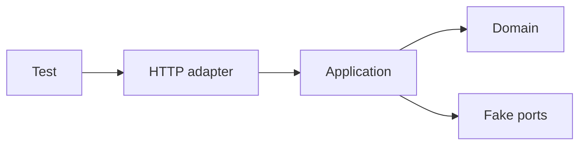
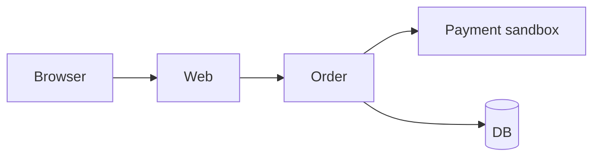

# Unitからproduction verificationまでの境界設計

## Test levelは距離ではなく境界

「Unit < Integration < E2E」という一直線だけで考えると失敗します。実際には次の軸があります。

| Axis | Small side | Large side |
|---|---|---|
| code scope | function | system |
| process | in-process | multi-process |
| infrastructure | in-memory | managed production service |
| interface | direct call | browser/device/network |
| ownership | one team | many teams/vendor |
| determinism | controlled | real-world variability |

同じHTTP API testでも、serverをin-processで起動するtestと、production-like clusterへ送るtestは別物です。

## Unit test deep dive

### Unitとは

unitをclassに固定しません。

- pure function
- value object
- aggregate
- behaviorを実現する小さなobject graph
- application serviceをcollaborator doubleで囲んだもの

### Unit testの2つの流派

#### Classical／sociable

軽量なreal objectを一緒に動かし、state/resultを確認します。

```text
Cart + PricingPolicy + DiscountRuleを本物で動かす
最終totalをassert
```

#### London／solitary

subject以外をdoubleにし、message/protocolを確認します。

```text
CheckoutServiceだけをsubjectにする
PaymentGateway.captureとOrderRepository.saveをverify
```

どちらもUnit testです。mockの有無でunit/integrationを分類しません。

### Unit testが向くfailure

- calculation/branch
- invariant
- error mapping
- state transition
- orchestration decision
- boundary partition

### Unit testで無理をしないfailure

- ORM mapping
- SQL isolation
- HTTP serialization
- browser rendering
- process configuration
- service compatibility

## Component test deep dive

componentはdeployable unit全体またはuse case sliceをin-processで動かし、process外を置換します。



### 強み

- real application wiring
- Unitより広いbehavior
- E2Eより速くfailureが局所的
- external failureを自由に注入

### 弱み

- fakeがreal serviceとずれる
- framework bootが遅くなりやすい
- component boundaryが曖昧だと巨大化

### 実装例

Spring Bootならfull contextを常に起動するのではなく、sliceとfull componentを使い分けます。Nodeならreal router/serverをephemeral portで起動し、DB/payment portをfakeにします。

## Adapter test

adapter単体でprotocol変換を確認します。

### HTTP adapter

- routing
- validation
- status/header/body
- content negotiation
- error mapping
- size limit
- cancellation

### Persistence adapter

- mapping
- query semantics
- constraint
- transaction
- concurrency/locking
- migration compatibility

### Messaging adapter

- serialization
- key/partition
- header/tracing
- ack/nack
- retry/DLQ
- duplicate/order

business ruleまでadapter testに重複させません。

## Integration test deep dive

integration testは「real boundary」を少なくとも1つ含みます。名前に対象を入れます。

```text
OrderRepositoryPostgresIntegrationTest
PaymentClientWireMockIntegrationTest
OrderPublisherKafkaIntegrationTest
CheckoutServiceConfigurationIntegrationTest
```

詳しくは[20-integration-testing-deep-dive.md](20-integration-testing-deep-dive.md)で扱います。

## Contract test deep dive

### Schema contract

providerが公開する可能なshapeを定義します。

### Consumer-driven contract

consumerが実際に依存するinteractionを定義します。

### Compatibility test

old/new schema、binary、client/server version間を確認します。

### Contractで保証しないもの

- provider internal business correctness
- network infrastructure
- authentication provider wiring
- end-to-end user journey
- performance

## Subcutaneous test

UI直下のservice/APIからsystemを操作するtestです。UIの脆さを避けつつ、広いbusiness flowを確認します。

```text
Browser UIを通さない
Application serviceまたはpublic APIを通す
DBとdomainは本物
```

E2Eを減らしながらsystem behaviorを広く確認するのに有効です。

## System test

deployable servicesを本番に近い構成で動かし、system requirementを確認します。

- cross-service workflow
- configuration/service discovery
- auth/identity propagation
- observability propagation
- data consistency
- upgrade compatibility

environment ownershipとtest data isolationが難しくなります。

## E2E test

利用者または外部systemの入口から、重要なoutcomeまで確認します。



E2Eでもpayment sandboxやemail captureを使うことがあります。「全部production real」である必要はありません。どの境界を制御したかを書きます。

## Acceptance test

acceptanceはscopeではなく、stakeholderが完成条件を受け入れるためのtestです。Unit levelでもAPI levelでもUI levelでも実装できます。

## Smoke test

広く浅く、build/deployが最低限機能するかを短時間で確認します。

良いsmoke:

- process start/health
- login
- one critical read/write
- dependency connectivity

smokeで全business ruleを網羅しません。

## Sanity test

特定変更後に主要機能が合理的に動くかを短く確認する言葉です。組織ごとに意味が違うため、suite名より対象を具体化します。

## Regression test

既存behaviorが変更で壊れていないかを確認します。Unit、integration、E2Eなどどのlevelにも存在します。Regressionはlevelではなく目的です。

## Re-test／confirmation test

報告されたdefectが修正されたか、同じ条件で再確認します。Regression testは周辺への影響、re-testは当該defect修正を主に確認します。

## Installation test

- clean install
- upgrade
- downgrade/rollback
- configuration default
- permission
- path/locale
- uninstall/cleanup

desktop、CLI、agent、on-prem productでは重要です。

## Migration test

database/data/API/config migrationの前後を確認します。

```text
old app + old schema
new schema backward-compatible phase
old/new app mixed traffic
backfill
constraint enforcement
rollback boundary
```

happy pathだけでなく、途中停止とresume/idempotencyを確認します。

## Backup/restore/DR test

backup fileが存在するだけでは不十分です。

- restore可能
- RPO/RTOを満たす
- encryption keyが利用可能
- cross-region/account restore
- application consistency
- runbookと担当者
- 定期演習

peopleとprocessもSUTです。

## Canary verification

small cohortへ新versionを出し、old/new metricを比較します。

- error rate
- latency
- business conversion
- resource saturation
- invariant violation

abort/rollbackを自動化し、sample size不足を成功と誤認しません。

## Shadow testing

production trafficをnew systemへ複製し、responseをuserへ返さず比較します。

注意:

- side effect抑止
- PII/data handling
- nondeterministic response normalization
- traffic amplification
- downstream cost

## Synthetic monitoring

本番へ定期的なtest transactionを送ります。

- dedicated account
- data tagging
- cleanup
- alert ownership
- rate/cost control
- third-party terms

## Test level選択例

### Risk: discount境界が誤る

最小: Unit parameterized/property。

### Risk: SQL unique constraintが効かない

最小: real Postgres adapter integration。

### Risk: frontendがbackend field削除で壊れる

最小: contract + component。

### Risk: OAuth redirect/cookie/browser behavior

最小: browser E2E。

### Risk: region failureから復旧不能

最小: controlled DR/chaos exercise。

## Anti-pattern: ice cream cone

manual/E2Eが多く、Unit/Componentが少ない状態です。遅いだけでなく、failure diagnosisとfailure injectionが弱くなります。

ただし比率だけで善悪を決めません。legacy UI productなど、現実の制約とriskから段階的に下位層へ移します。

## Anti-pattern: mock pyramid

Unit testは大量にあるが、real DB/network/wiringをほとんど確認しない状態です。高速greenでもproduction integration bugが漏れます。

## Boundary review checklist

- [ ] test level名でなくreal boundaryを列挙
- [ ] lower levelで同じriskを安く検出できないか
- [ ] higher levelでしか分からないwiringを残したか
- [ ] fakeとreal adapterのcontractを検証
- [ ] shared environment依存を明示
- [ ] data cleanup/parallel isolationを設計
- [ ] process/team/runbookも必要ならSUTに含める

