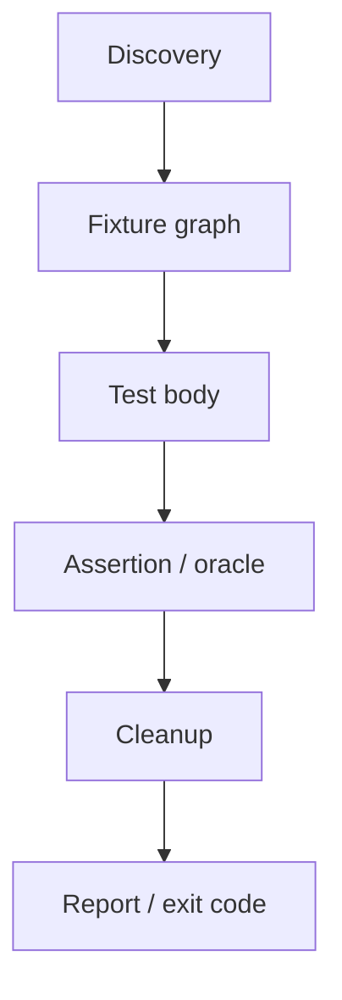

# 言語とテストフレームワークの内部構造

## 一言でいうと

どの言語でもテストは「発見→準備→実行→判定→報告」ですが、型・module・並行処理・build systemが違うため、自然な設計も変わります。

## Frameworkを分解する

| 部品 | 責務 | 例 |
|---|---|---|
| runner | process、並列、終了code | Node `--test`、JUnit Platform、MTP、`cargo test` |
| discovery | testを見つける | naming、annotation、macro、registration |
| lifecycle | setup/teardown、fixture scope | pytest fixture、JUnit extension |
| assertion | expectedとactualを比較 | Truth、Chai、FluentAssertions |
| double | spy/stub/mock/fake | Sinon、Mockito、MockObject |
| parameterization | dataごとのcase生成 | pytest parametrize、JUnit parameterized |
| reporter | console/XML/HTML/trace | TAP、JUnit XML、Playwright trace |
| plugin/extension | hook、custom behavior | pytest plugin、JUnit extension |

「JestとChaiを比較」のような異カテゴリ比較を避けます。

## 共通の実行モデル

frameworkを選ぶときはsyntaxより、isolation、parallel scheduling、extension model、diagnostics、ecosystem integrationを見ます。

## Python / pytest

- dynamic typingゆえ入力の種類をparameterize/propertyで広げやすい
- fixtureはdependency injection graphとして機能する
- fixture scope (`function/class/module/session`) が速度と隔離を左右する
- monkeypatchは便利だがmodule lookup locationを誤ると偽のtestになる
- `unittest.mock`のautospecで存在しないmethodのmockを減らせる

良い形は、pure domainは小さなfunction test、I/O adapterはfixtureでreal resource、process boundaryはcontract/integrationに分けることです。

実行可能なfixture scope、xdist、Hypothesis、lookup-site patch、coverage/mutation比較は[`labs/python/PYTEST-LAB.md`](../labs/python/PYTEST-LAB.md)にあります。

## JavaScript / TypeScript

- event loop、promise、timer、module cacheが主要なnondeterminism源
- Node標準runnerは依存を減らせる
- Mochaはrunner/lifecycleを柔軟に組み、assertion/doubleを選ぶ思想
- AVAはtest isolationとconcurrencyを強く意識する
- Jest/Vitestはrunner、assertion、mock、snapshotを統合する

同一behavior、serial/concurrent scheduling、process/thread isolation、Node mockとSinon、ESM DI/module mock、unawaited failure outputの実測は[`labs/node/EXECUTION-MODEL.md`](../labs/node/EXECUTION-MODEL.md)にあります。
- TypeScript type testとruntime testは別。型が通ってもJSON入力は壊れ得る

`await`漏れ、fake timerとreal I/O混在、global mock、shared portを重点的にreviewします。

## Java / Kotlin・JUnit Platform

JUnitは単なるannotation集ではありません。

- Platform: launcher、engine、IDE/build integration
- Jupiter: programming/extension model
- Vintage: legacy互換のためのengine（構成による）

Java/Kotlinではcompile-time type safetyが強い一方、reflection、serialization、DI container、ORM mappingをintegrationで確かめる必要があります。Mockitoはinteractionを表現しやすいですが、全classをmockするとLondonの悪い側面が出ます。Truth/AssertJのfailure messageとdomain assertionを活用します。

JUnit 6.1.1のparameterized/dynamic/extension、Truth custom Subject、Jupiter/Vintage engine gate、Mockito agentのJDK 21/25 matrix、Kotlin coroutine testとの差分は[`labs/java/JVM-LAB.md`](../labs/java/JVM-LAB.md)にあります。

## C# / .NET

- test framework（NUnit/MSTest/xUnit）とtest platform/adapterを分けて考える
- async testは`Task`を返し、`async void`を避ける
- LINQ deferred execution、culture、nullable、DateTime kindに注意
- fixture lifecycleとparallelizable属性がshared stateへ影響する
- ASP.NETのin-process test hostはsubcutaneous/component testに向く

MTPは実行platform、MSTestはframework/adapterという層の違いを理解すると選定しやすくなります。NUnit/MSTest × MTP/VSTestの実測matrix、TRX option、failure diagnostic、採用判断は[.NET lab](../labs/dotnet/README.md)と[ADR-0002](adr/0002-adopt-microsoft-testing-platform.md)を参照してください。

## C++ / Catch2・doctest・GoogleTest

- compile/link/discovery costが大きい
- undefined behavior、memory safety、lifetime、ABIがtest設計へ入る
- RAIIでcleanupを確実にする
- sanitizers（ASan/UBSan/TSan/MSan）は普通のassertionとは別のruntime oracle
- template/compiler/standard library/optimization matrixが重要

single-headerの使いやすさ、compile time、registration、death test、mock supportを用途で比較します。

Catch2のSECTION/GENERATE、3 sanitizer defect fixtures、benchmark noise、手書きspy対Trompeloeilのclean compile cost、CTest shard/random seedの実測は[C++ lab](../labs/cpp/README.md)を参照してください。

## Go / 標準testing

- standard library中心でtable-driven testが自然
- small interfaceをconsumer側に置くとfakeが簡単
- subtestと`T.Parallel`はloop variable/shared fixtureに注意
- built-in fuzzing、benchmark、race detectorがrunnerと統合される
- goroutine leak、channel close、context cancellationを検証対象にする

mock frameworkを先に入れるより、小さいinterfaceとin-memory fakeを検討します。

## Rust / cargo test・rstest

- ownership/type systemが多くの不正状態をcompile時に排除する
- compile-fail/doc testでAPIの型上の契約を検証できる
- `#[cfg(test)]` unit testはprivate itemへアクセスできる
- `tests/`はpublic APIから見るintegration test
- traitによるdependency substitution、Result/Optionの明示性が強い
- unsafe、FFI、async runtime、interior mutabilityは追加testが必要

型で証明できることをruntime testで重複せず、unsafe boundaryとsemantic invariantへ集中します。

## PHP / PHPUnit

- request/process lifecycle、global/static state、autoload、framework containerに注意
- data providerでcaseを広げる
- PHPUnit MockObjectはboundary interactionに限定する
- dynamic value/array shapeはstatic analysisとruntime validationを併用する
- Infectionでmutation adequacyを確認する

## 言語機能が変えるテスト量

| 言語特性 | 減らせるruntime test | 依然必要なtest |
|---|---|---|
| static types | 不正型の単純case | parsing、semantic rule、I/O |
| algebraic data type | 未処理状態 | business transition |
| ownership/borrow | 一部memory misuse | unsafe/FFI/concurrency semantics |
| contracts/refinement | pre/postcondition一部 | integration、performance |
| dynamic typing | 少ない | type/shape boundaryを広く |

型はテストの代替ではなく、別の検証層です。

## Framework extensionを自作する前に

1. domain assertion/helperで十分か
2. fixture/factoryで十分か
3. existing pluginがmaintainedか
4. custom lifecycleがparallel/isolationを壊さないか
5. failure messageにsource locationが残るか
6. IDE/CI/JUnit XMLと互換か

独自DSLは短く見えても、学習・debug・migration costを増やします。

## 選定の実験

候補ごとに同じ5件を書きます。

1. pure calculation
2. parameterized edge cases
3. async failure
4. real DB integration
5. intentional failureのdiagnostics

測るものはcold/warm time、watch mode、parallel、IDE、failure diff、fixture ergonomics、plugin risk、upgrade policyです。
