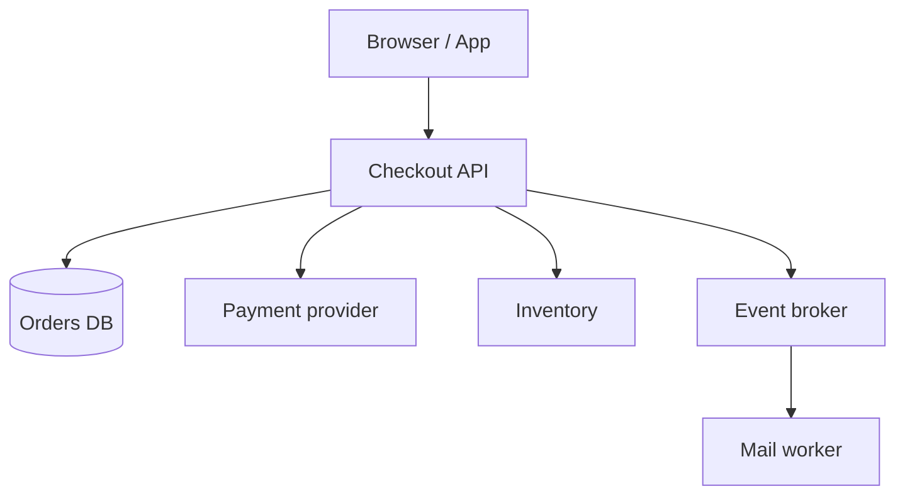

# ケーススタディ: ECサイトの完全テスト戦略

## 対象system

顧客が商品をcartへ入れ、couponを使い、在庫を確保し、外部payment providerで支払い、注文を作り、emailを受け取るsystemを考えます。



## まずriskを書く

| Risk | 影響 | 重要な性質 |
|---|---:|---|
| 二重請求 | 最大 | idempotency |
| 金額誤り | 最大 | money invariant |
| 在庫だけ減る | 大 | compensation/consistency |
| 注文なしで請求 | 最大 | state transition |
| coupon濫用 | 大 | authorization/rule |
| 個人情報漏洩 | 最大 | access control/redaction |
| sale時の遅延 | 大 | capacity/latency |
| checkout不能 | 大 | availability/degradation |

テスト数ではなく、このrisk tableをcoverageします。

## Domain unit tests

### 対象

- subtotal/tax/discount/rounding
- coupon eligibility
- order state machine
- retry/idempotency key generation

### 例

```text
Given 1000円の商品2点と10% coupon
When totalを計算
Then subtotal=2000, discount=200, payable=1800
```

さらにpropertyとして、`payable >= 0`、item順序でtotal不変、同一coupon二重適用不可を確認します。

## Classical component test

in-memory fake repository/payment gatewayを使い、checkout use case全体をstateで確認します。

```text
When checkout succeeds
Then order is PAID
And exactly one charge record exists
And outbox contains OrderPaid
```

内部methodの呼出順ではなく、公開結果を守ります。

## London interaction test

外部payment commandのprotocolが重要なadapterではinteractionを確認します。

```text
charge(amount=1800, currency=JPY, idempotencyKey=order-42)
```

金額、通貨、idempotency keyは契約の一部です。一方、private helperの呼出順は固定しません。

## Database integration

本物のengineで次を確認します。

- unique idempotency key
- money precision/scale
- transaction rollback
- outboxとorderのatomic write
- migration up/old-data compatibility
- concurrent checkout conflict
- query/index performance

in-memory DBだけではengine固有のlock、constraint、SQLを守れません。

## Payment contract test

consumer側が実際に使うrequest/response、error、timeout、webhook signatureを契約化します。

- amount/currency shape
- idempotency semantics
- declined/temporary failure mapping
- unknown field compatibility
- webhook replay

contract greenでもproviderの本番networkや資格情報は保証しないためsandbox smokeも残します。

## Messaging integration

at-least-once deliveryを前提にします。

- duplicate `OrderPaid`でもemailは一通
- out-of-order eventを安全に扱う
- consumer crash後redelivery
- poison message/DLQ
- schema evolution
- observability: message/order correlation

「publish methodを1回呼んだ」だけではbroker integrationを検証できません。

## API tests

### Schema/contract

status、JSON shape、required field、error formatを確認します。

### Behavior

- unauthorized/forbidden
- invalid coupon
- out-of-stock
- payment decline/timeout
- duplicate request
- rate limit
- locale/currency

### Property/fuzz

OpenAPI schemaからinvalid/edge inputを生成し、5xx、information leak、hangを探します。

## UI component tests

- cart quantity keyboard操作
- error message association
- loading/disabled state
- currency/locale rendering
- responsive layout
- screen reader name/role/value

network responseはcontrolled fakeにし、UI stateを高速に網羅します。

## E2E journeys

少数の価値あるjourneyだけにします。

1. standard checkout
2. payment declined then retry
3. duplicate submitでも一回だけ請求
4. expired inventory/coupon
5. keyboard/screen-reader critical path

stable role/label selector、condition-based wait、APIによるtest data setup、unique user/orderを使います。

## Acceptance / ATDD

product、engineering、QA、operationsがexampleを作ります。

```gherkin
Scenario: 通信timeout後の再送で二重請求しない
  Given 注文42の最初の決済結果をclientが受信できない
  When 顧客が同じ注文を再送する
  Then 顧客への請求は1800円の1件だけである
  And 注文42は支払済みである
```

これはUI scriptの書式ではなく、business ruleの共同理解です。

## Performance

SLO例:

```text
steady 500 checkout/s
p95 < 400ms, p99 < 900ms
error < 0.1%
sale spike 3x for 10min
```

load、spike、soakを分け、結果の正しさ、queue lag、DB lock、provider rate limit、autoscalingも観測します。

## Security

- user Aがuser Bのorderを読めない
- coupon/admin endpointのauthorization
- priceをclient inputから信用しない
- webhook signature/replay window
- PII/tokenをlog/reportへ出さない
- dependency/container/IaC scan
- abuse rate limitとbot scenario

## Resilience / chaos

- payment timeout/late success
- inventory partial outage
- broker unavailable
- DB failover/connection exhaustion
- email outageはcheckoutを止めない
- region outage/restore

定常状態、注入fault、期待degradation、abort conditionを先に決めます。

## Data/analytics

- orders totalとpayment settlement reconciliation
- refund/tax/currency consistency
- duplicate/missing event
- daily partition/timezone
- PII retention/deletion

## Production verification

- post-deploy smoke
- canary error/latency/business KPI
- synthetic checkoutは実請求しない専用route/account
- shadow requestは副作用を抑止
- rollback条件
- SLO/incidentからregression test追加

## CI配置

| Lane | 内容 |
|---|---|
| local | domain、component、type/lint |
| PR | DB integration、contract、API、UI component、少数E2E |
| main | 全integration、browser matrix、mutation差分 |
| nightly | fuzz、full mutation、security、soak subset |
| release | migration、capacity、DR、sandbox provider |
| production | canary、synthetic、SLO |

## Traceability matrix

| Risk | 主test | 補助test | Production signal |
|---|---|---|---|
| 二重請求 | property/state model、concurrency DB | E2E duplicate submit | duplicate charge alarm |
| 金額誤り | domain property、differential | API/E2E | reconciliation |
| payment不整合 | component、contract、fault injection | sandbox smoke | settlement mismatch |
| 遅延 | load/spike/soak | microbenchmark | p95/p99/SLO |
| PII漏洩 | authorization/security | E2E | audit/DLP alert |

## 完了条件

- [ ] 全critical riskにowner、test、production signalがある
- [ ] money/idempotencyはexampleだけでなくproperty/state/concurrencyで守る
- [ ] real DB/broker/provider contractの境界がある
- [ ] E2Eは重要journeyへ限定しartifactが十分
- [ ] migration、performance、security、resilience、DRをrelease計画に含める
- [ ] incidentをregressionへ戻すloopがある

