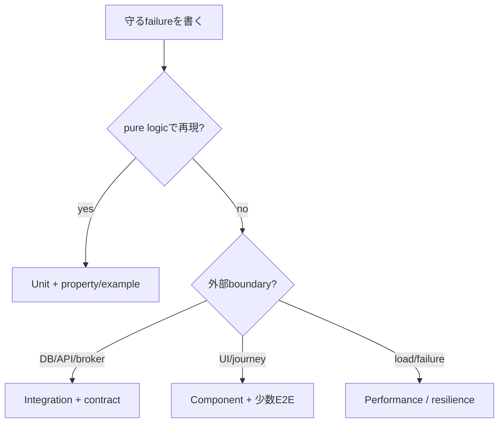

# どのテストを書くか: Decision guide

## 最初の質問

> 今回の変更で、利用者・事業・運用に起き得る最も痛い失敗は何か。

名前から選ばず、failureから逆算します。

## 症状から選ぶ

| 心配 | 第一候補 | 補助 |
|---|---|---|
| 計算rule | unit example/property | mutation |
| 複雑な状態遷移 | model/stateful property | example |
| parser/crash | fuzz/grammar fuzz | sanitizer |
| 正解値を作れない | metamorphic/differential | manual sample |
| SQL/transaction | real DB integration | component fake |
| API変更 | contract/schema | sandbox smoke |
| broker重複・順序 | messaging integration | model/fault injection |
| browser操作 | UI component | critical E2E |
| 見た目 | visual regression | human approval |
| 支援技術 | accessibility automation | screen reader/manual |
| 遅い | benchmark/load | profiling |
| 攻撃 | threat-based security | SAST/SCA/DAST/pentest |
| 障害復旧 | fault injection/resilience | chaos/DR |
| data欠損 | constraint/reconciliation | production monitoring |
| ML/LLM品質 | versioned evaluation set | online/shadow |
| release後の問題 | canary/synthetic/SLO | rollback drill |

## Doubleを使うか

| 質問 | Yesなら |
|---|---|
| rare failureを再現したい? | controllable stub/fake |
| outbound protocol自体が重要? | focused spy/mock/contract |
| 本物が高速・決定的・local? | 本物を優先 |
| fakeが本物と乖離しやすい? | contract testを追加 |
| internal collaboratorか? | mock前にreal objectを検討 |

## どこまで本物を使うか

最も低い有効なboundaryを選びます。

1. pure functionで同じfailureを再現できるならunit
2. framework wiringが関係するならcomponent
3. engine/protocol semanticsが関係するならintegration
4. user journeyだけで見えるならE2E
5. scale/failure/production topologyが関係するなら専用環境またはproduction verification

## Oracleを選ぶ

| 状況 | Oracle |
|---|---|
| exact answer既知 | expected output |
| 一般rule | invariant/property |
| reference実装あり | differential |
| 変換関係が既知 | metamorphic |
| 状態仕様あり | model/state machine |
| protocol | contract/schema |
| 視覚artifact | snapshot/golden + review |
| 人間品質 | rubric/manual/user study |
| probabilistic output | distribution/confidence/calibrated judge |

## 最後の停止条件

次を答えられなければ、testを追加する前に設計をやり直します。

- このtestが落ちたとき、どのriskを疑うか
- passしても何は保証されないか
- failureを1回で再現する情報があるか
- より安く同じriskを守るtestがないか
- 誰が保守し、いつ実行し、いつ削除するか

