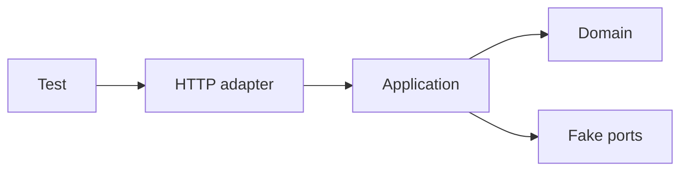
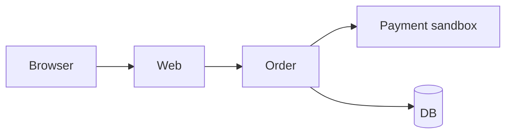
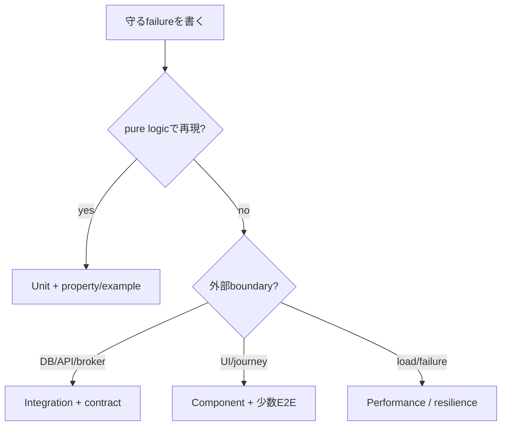

# 観点2 設計・oracle・テストレベル

> Testing Frameworks Handbook のNotebookLM取り込み用バンドル。
> 生成元: https://github.com/hjosugi/testing-lab （scripts/build-notebooklm.sh で再生成）

---

<!-- SOURCE: docs/05-boundaries-and-portfolio.md -->

# 境界とテストポートフォリオ

## pyramidより変更リスクから考える

unitを大量、integrationを中量、E2Eを少量という形は有用なheuristicですが、比率を目標にしません。欠陥の種類、変更頻度、実行時間、診断性からportfolioを決めます。

| Risk | 最初の選択 | 補完 |
|---|---|---|
| calculation bug | pure unit/property test | mutation test |
| orchestration bug | application unit/component test | interaction test |
| ORM/query mismatch | real DB integration | migration test |
| API breaking change | consumer/provider contract | smoke E2E |
| browser wiring | component/browser test | critical journey E2E |
| resilience | fault injection/component test | controlled chaos |

## boundaryを置く場所

test seamは技術都合だけでなくownership boundaryに置きます。

- process boundary: HTTP、message broker、filesystem
- nondeterminism boundary: clock、random、UUID
- persistence boundary: repository／transaction
- policy boundary: tax、pricing、authorization rule
- hardware/UI boundary: browser、mobile OS、game engine

## hermeticityの段階

1. pure in-memory
2. local process／temporary filesystem
3. ephemeral real infrastructure
4. shared test environment
5. production smoke

上に行くほど現実性が増えますが、速度、再現性、ownershipが難しくなります。同じ保証を全段階で重複させず、各段階でしか検出できないfailureを狙います。

## test contract for fakes

fake repositoryが本物と同じcontractを満たすか、同一suiteを両方へ実行します。

```text
RepositoryContract
  saves and reloads an order
  rejects duplicate id
  preserves version for optimistic locking

run against InMemoryOrderRepository
run against PostgresOrderRepository
```

これがないfakeは、便利な別実装にすぎず、本番の代替観測として信用できません。

## CI lane

| Lane | 目標 | 内容 | Block |
|---|---|---|---|
| fast | 5分以内 | lint、type、unit、small component | PR |
| integration | 15分目安 | DB、broker、contract provider | PR/merge policy |
| release | 30分以上可 | critical E2E、migration、security | deploy |
| scheduled | 夜間 | mutation、full fuzz、chaos、cross-browser | alert/triage |


---

<!-- SOURCE: docs/06-test-doubles.md -->

# Test doubles

## 用語

| Double | 役割 | 検証対象 |
|---|---|---|
| Dummy | signatureを満たすだけ | 通常なし |
| Stub | 決めた値を返す | subjectのoutcome |
| Spy | 呼び出しを記録 | 後からinteractionをassert |
| Mock | 期待interactionを先にprogram | protocol |
| Fake | 簡略だが動作する実装 | state／behavior |

libraryによって用語は違います。API名ではなくtest内の役割で分類します。

## どれを選ぶか

```text
戻り値だけ制御したい -> stub
重要なevent送信を確認したい -> spy
厳密なprotocol/順序が仕様 -> mock
複数operationのstateful behaviorが必要 -> fake
parameterとして必要なだけ -> dummy
```

## 最も安定するinteraction assertion

すべてのcallを検証せず、business consequenceを持つinteractionだけを検証します。

安定しやすい例:

- paymentを二重captureしない
- transaction commit後にeventをpublishする
- PIIを含むpayloadを外部へ送らない
- idempotency keyをremote APIへ渡す

不安定になりやすい例:

- helper Aの次にhelper Bを呼ぶ
- getterを3回呼ぶ
- DTO constructorの全fieldをexact match
- cache miss時のinternal call chain全体

## mockとfakeのtradeoff

mockは局所的でfailureが明瞭ですが、interaction couplingがあります。fakeは複数operationを自然に扱えますが、本物とのsemantic driftが起きます。

判断基準:

- protocol自体を設計する: mock/spy
- state transitionを検証する: fake
- SQL/HTTP driverの現実性が必要: real integration
- failure modeを網羅的に注入: stub/fake

## anti-pattern

- mock returns mockの深いchain
- production data classをmock
- private methodをmock
- third-party APIを直接mockして自分のadapterを通さない
- global patchをrestoreしない
- random test dataにseed/intentがない
- fakeが本番制約を無視する


---

<!-- SOURCE: docs/14-complete-testing-taxonomy.md -->

# 全テスト種別の完全taxonomy

「unitかintegrationか」だけでは設計できません。次の5項目でtestを定義します。

```text
scope: 何を起動するか
boundary: どの境界を本物にするか
double: 何を置換するか
oracle: 何を正しいと判定するか
purpose: どのriskを検出するか
```

この5項目をsuite名へ落とすときは、[全体マップのTeam標準](00-map.md#team標準のtest-level定義)を正とします。特にintegration系suiteは、実物にするboundaryを省略しません。現在の実装は[labsのsuite mapping](../labs/README.md#現在のsuite-taxonomy-mapping)で追跡します。

## 1. Build前／static verification

| 種類 | 検出対象 | Tool例 |
|---|---|---|
| compiler/type check | type、syntax、exhaustiveness | javac、tsc、rustc、mypy |
| lint/static analysis | bug pattern、style、data flow | ESLint、SpotBugs、Clippy、Semgrep |
| SAST | security weakness | CodeQL、Semgrep、language analyzers |
| SCA/license | vulnerable dependency、license | OSV-Scanner、Dependabot、SBOM tool |
| formal/spec check | invariant、state/model | TLA+、Alloy、Dafny |
| IaC policy | insecure/misconfigured infra | cfn_nag、OPA/Conftest、Checkov |

static verificationはtest runnerを起動しませんが、quality portfolioの一部です。type systemが保証することをruntime testで重複しすぎないようにします。

## 2. Developer tests

| 種類 | Scope | Oracle | 主な用途 |
|---|---|---|---|
| example-based unit | function/class/behavior | expected value/state/interaction | business rule |
| sociable unit | in-memory object graph | public outcome | domain collaboration |
| solitary unit | subject + doubles | interaction/result | orchestration protocol |
| parameterized/table | 同behavior、多case | expected per case | boundary matrix |
| property-based | 多数生成input | invariant/property | broad input space |
| fuzz | malformed/random input | no crash/hang + invariant | parser/security boundary |
| concurrency/race | threads/tasks/schedules | safety/liveness | race、deadlock |
| mutation | modified production variants | tests must fail | suite strength |
| characterization | legacy behavior | captured current behavior | safe refactor |
| regression | past defect | defect must not recur | incident prevention |
| snapshot/golden | structured/rendered output | reviewed artifact | compiler/UI/serialization |
| approval | human-approved output | approved baseline | complex output |

snapshot更新を一括承認するとoracleを捨てます。差分のbusiness meaningをreviewします。

## 3. Componentとintegration

`integration test`というカテゴリ名だけでは実行範囲が曖昧なので、実際のsuite名には必ず境界を入れます。

| 推奨名 | 本物 | 置換 | 検出対象 |
|---|---|---|---|
| in-process component test | application component | process外port | module wiring |
| repository-Postgres test | SQL/driver/real Postgres | 他service | schema/query/transaction |
| HTTP adapter test | router/serializer/HTTP stack | DB/remote API可 | status/header/body |
| message adapter test | serializer/broker client | downstream | routing/ack/retry |
| filesystem integration | OS/filesystem | remote | permission/path/atomicity |
| multi-process integration | app + selected dependency | remaining services | network/config/protocol |
| system integration | deployable services群 | third party可 | cross-service workflow |

Testcontainers、Docker Compose、ephemeral namespaceはreal dependencyを短命に起動します。in-memory databaseはSQL dialect、locking、transaction、index behaviorを再現しない場合があるため、本番DBの代替とみなしません。

## 4. APIとcontract

| 種類 | Source of truth | 例 |
|---|---|---|
| schema conformance | OpenAPI/JSON Schema/GraphQL schema | Dredd、Schemathesis、Prism |
| consumer-driven contract | consumer usage例 | Pact |
| provider contract | provider spec + implementation | OpenAPI validator |
| backward compatibility | old/new schema/artifact | protobuf/OpenAPI diff |
| API functional | business scenario over HTTP | REST Assured、Karate、Pactum、Hurl |
| service virtualization | programmed/recorded remote behavior | mountebank、WireMock、MockServer |

PactとPactumは名前が似ていますが別物です。Pactはconsumer-driven contract、PactumはREST API test toolです。

record/replayは便利ですが、secret/PII、stale fixture、nondeterministic field、provider driftを管理します。

## 5. Acceptance／BDD／ATDD／SBE

これらはtest layerよりcollaborationとspecificationの方法です。

- BDD: exampleでbehaviorを発見し、ubiquitous languageを作る
- ATDD: 実装前にacceptance criteriaをexecutableにする
- Specification by Example: concrete exampleでruleと例外を明確化
- Gherkin/Cucumber/Gauge: executable specificationの表現/runner

Gherkinを使うだけではBDDになりません。UI操作手順ではなくbusiness ruleを表現します。

```gherkin
Scenario: Declined payment does not confirm the order
  Given a cart total of 1200 yen
  And the payment provider will decline the charge
  When the customer checks out
  Then the order is not confirmed
  And no confirmation event is published
```

## 6. UI test

| 種類 | Scope | Tool例 | 注意 |
|---|---|---|---|
| logic unit | reducer/hook/view model | language runner | DOM不要なlogic |
| component | component + DOM/browser | Testing Library、Storybook test | user-visible query |
| interaction | rendered component story | Storybook play/browser test | component state |
| visual regression | screenshot/render tree | Playwright、Chromatic等 | font/OS/threshold固定 |
| accessibility | DOM/AX tree/rules | axe-core、Playwright | 自動検査だけで完結しない |
| browser E2E | deployed app + browser | Playwright、Cypress、TestCafe | critical journeyに限定 |
| cross-browser | Chromium/Firefox/WebKit | Playwright、WPT | engine差 |
| responsive/device | viewport/input/emulation | browser tools | emulation≠real device |

Testing Libraryの中心は「実装detailよりuserの使い方に近いquery」です。CSS classやcomponent instanceを直接検証しすぎません。

## 7. Mobile／desktop／game／embedded

| Surface | 主なtest | Tool例 |
|---|---|---|
| native iOS | unit/UI/snapshot/device | XCTest/XCUITest、EarlGrey |
| native Android | JVM/device/UI | JUnit、Robolectric、Espresso、Kakao |
| React Native | component/gray-box E2E | Testing Library、Detox、Cavy |
| cross-platform mobile | W3C WebDriver E2E | Appium |
| Windows desktop | UI Automation/WebDriver | Appium Windows driver等 |
| game/Unity | engine object/image/device | Unity Test Framework、Airtest/Poco |
| embedded/firmware | host unit/HIL/SIL | Unity/Ceedling、hardware rig |
| PLC | industrial runtime | TcUnit |

simulator/emulator、real device、hardware-in-the-loopは検出できるfailureが違います。device farmは最後だけでなく、OS/device matrixをrisk-basedで選びます。automation mechanism、substrate、artifact、hardware owner/予約を分ける実用matrixは[Mobile／desktop／game／device matrix設計](32-mobile-desktop-game-device-matrix.md)を参照してください。

## 8. E2E／system／release

| 種類 | 目的 |
|---|---|
| smoke | build/deployが最低限使える |
| critical journey E2E | 最重要user valueが通る |
| system test | complete system requirement |
| interoperability | version/vendor間互換 |
| installation/upgrade | install、migration、rollback |
| backup/restore | RPO/RTOとdata integrity |
| disaster recovery | region/service failure recovery |
| exploratory/manual | 未知risk、UX、曖昧なbehavior |
| usability | userが目標を達成できるか |

E2Eは「全部本物」ではありません。第三者決済のsandbox、clock control、email captureなど、制御されたtest boundaryを明記します。

## 9. Non-functional

### Performance

| 種類 | 問い |
|---|---|
| microbenchmark | function/operatorのcostは変化したか |
| benchmark | component throughput/latency |
| load | 想定trafficでSLOを満たすか |
| stress | 限界とdegradationはどうなるか |
| spike | 急増から安定/回復するか |
| soak/endurance | leak、queue buildup、劣化がないか |
| scalability | resource増加に対する伸び |
| capacity | 安全な最大負荷 |

coordinated omission、warm-up、client bottleneck、percentile集計、test data realismに注意します。functional E2E toolで性能を測らないでください。

### Security

- SAST、SCA、secret scan、IaC scan
- DAST、API security test
- fuzzing、protocol conformance
- penetration test、red team
- authn/authz/tenant isolation test
- supply-chain/SBOM/provenance verification
- abuse caseとrate limit test

OWASP ASVS/WSTGなどのstandardへtraceします。

### Resilience

- fault injection
- chaos experiment
- retry/backoff/circuit breaker test
- dependency latency/partial failure
- failover/recovery
- deterministic simulation

steady-state hypothesis、blast radius、abort condition、observabilityを先に定義します。

## 10. Data／analytics／ML／LLM

| 対象 | Test |
|---|---|
| ETL/ELT | schema、null、range、uniqueness、referential integrity |
| data pipeline | source-to-target reconciliation、late data、idempotency |
| model | offline metric、slice、robustness、drift、fairness |
| ML system | training-serving skew、feature leakage、reproducibility |
| LLM prompt/RAG | golden set、retrieval recall、groundedness、safety |
| agent | tool contract、state transition、sandbox、budget、trajectory |

LLM-as-judgeは単独oracleにせず、calibration、人手sample、inter-rater agreement、judge model/version固定、position/order biasの確認を行います。非決定的systemはthresholdだけでなくdistributionとslice別failureを見ます。

## 11. Production verification

| 種類 | 役割 |
|---|---|
| canary | 小trafficで新versionを検証 |
| shadow | responseをuserへ返さず新系へ複製 |
| synthetic | 定期的にjourney/APIを実行 |
| feature flag experiment | cohort単位で安全に有効化 |
| runtime invariant | 不正stateを検知 |
| observability assertion | trace/metric/logからSLO/flowを検証 |
| replay | sanitized production trafficを再実行 |

production testはblast radiusとdata safetyを持つ必要があります。synthetic account、idempotent cleanup、明示tagを使います。

## 12. Continuous testing

continuous testingは特定toolではなく、changeからproductionまで継続してrisk signalを返すoperating modelです。

```text
editor: focused unit/property
pre-commit: static + affected unit
PR: fast + selected integration/contract
merge: wider integration + E2E
release: migration/performance/security
production: canary + synthetic + invariant
scheduled: mutation + full fuzz + chaos + compatibility matrix
```

Wallaby.jsのようなcontinuous runner、GoCDのようなdelivery platform、Kuberhealthyのようなsynthetic operatorは別カテゴリです。

## Tool名から誤分類しないための例

| Tool | 分類 |
|---|---|
| Playwright | browser automation + test runner |
| Testcontainers | ephemeral dependency lifecycle library |
| Jest/Mocha/AVA | JS test runner/framework |
| Testing Library | user-centric UI query/test utility |
| Storybook | component workshop + testing surface |
| Pact | consumer-driven contract |
| Pactum/Karate/REST Assured/Hurl | API functional/integration |
| Dredd/Schemathesis | spec-based API testing |
| Prism | OpenAPI mock/validation proxy |
| LocalStack | cloud service emulator |
| Keploy/GoReplay | traffic capture/replay/sandbox |
| k6/JMeter | load/performance |
| Infection/Stryker/PIT | mutation |
| Detox/Appium/Airtest | mobile/app automation |
| promptfoo等 | LLM evaluation/red-team layer |

---

<!-- SOURCE: docs/16-how-to-design-any-test.md -->

# あらゆるテストを設計する共通手順

テスト名を先に選ばないでください。「integration testを追加する」ではなく、「どの故障を、どの観測点で、どの時間予算内に検出するか」から設計します。


> 実行例: test dataの設計は[`labs/test-data`](../labs/test-data/README.md)です。meaningful defaultのfactory、名前空間付きID、manifest（clock/seed/locale）、並列processでの衝突防止、namespace cleanup、production data匿名化とartifactのPII/secret検査をtestします。

## 1. Test design card

本書のすべてのテストは次のカードで設計します。

```yaml
name: payment capture idempotency
risk:
  event: retryによる二重請求
  impact: critical
  likelihood: medium
  detectability_without_test: low
system_under_test: CheckoutApplicationService
real_components:
  - application service
  - domain model
replaced_components:
  - payment provider: controllable protocol fake
stimulus:
  - same command and idempotency key sent twice
oracle:
  - exactly one provider capture
  - same order result returned twice
controlled_nondeterminism:
  - clock
  - UUID generator
failure_classes:
  - duplicate charge
  - different result for replay
cannot_detect:
  - provider production outage
  - network TLS incompatibility
execution:
  lane: PR-fast
  timeout: 200ms
  parallel: safe, unique order id
evidence:
  - failure message contains idempotency key and calls
owner: payments-team
```

このカードが書けなければ、test codeを書く前に仕様か境界が不足しています。

## 2. Riskを具体的なfailure eventにする

「品質を上げる」はtest requirementではありません。次の形にします。

```text
Given <system state>
When <fault or action>
The system may <undesired observable consequence>
Impact is <business/technical damage>
```

例:

- 在庫が残り1個のとき、2 requestが並行すると、在庫が負になる可能性がある。
- schema migration中にold appがwriteすると、new non-null columnでrequestが失敗する可能性がある。
- consumerがfieldを必須としているのにproviderが削除すると、checkoutがdeserializeできない。
- DST切り替え時にlocal timeを使うと、subscriptionが二重請求される。

## 3. SUT boundaryを決める

SUTは必ずしもclassではありません。

| Boundary | 適する問い | 典型的な実物 |
|---|---|---|
| function/value | calculationは正しいか | pure code |
| object/aggregate | invariantを保つか | domain objects |
| application component | use caseが協調するか | service + domain + fake ports |
| adapter | protocol/serializationは正しいか | HTTP/SQL/message adapter |
| deployable service | config/wiring/runtimeは正しいか | process + selected real dependencies |
| system | user journeyが通るか | multiple services/browser |
| socio-technical process | restore/incident responseが機能するか | people + runbook + systems |

boundaryを広げるほどrealismは増えますが、原因局所性、速度、制御性が落ちます。広いtestを否定せず、そのtestでしか観測できないriskがあるかを確認します。

## 4. Observation pointを選ぶ

同じbehaviorでも観測場所でtestの意味が変わります。

| Observation | 例 | 長所 | 弱点 |
|---|---|---|---|
| return value | calculated total | 速い、局所的 | side effectを見ない |
| state | persisted order | refactorに強い | fake drift |
| interaction | payment capture call | protocolを直接検証 | implementation coupling |
| emitted event | OrderConfirmed | async contractを検証 | delivery保証は別 |
| wire bytes | HTTP/Protobuf payload | protocol精度 | business intentが読みにくい |
| UI/AX tree | accessible button/name | user interfaceを検証 | backend semanticsは限定的 |
| metrics/traces | retry count/span graph | distributed flow | instrumentation bugの影響 |
| external effect | email/device/payment sandbox | realism | cost/flake/cleanup |

最も狭く、かつriskを直接表す観測点を選びます。

## 5. Oracleを選ぶ

oracleはpass/failを決める仕組みです。expected valueだけではありません。

- exact example
- predicate/invariant
- reference implementation
- previous stable version
- independent implementation
- metamorphic relation
- model/state machine
- schema/contract
- human approval
- statistical threshold/distribution
- runtime SLO/business invariant

oracleの誤りはtest generatorの誤りより危険です。詳しくは[17-test-oracles-deep-dive.md](17-test-oracles-deep-dive.md)で扱います。

## 6. Controllabilityを設計する

テストはsystemを必要な状態へ運べなければなりません。

制御対象:

- clock/timezone/calendar
- randomness/UUID
- thread/task scheduler
- network delay/drop/duplicate/reorder
- disk full/I/O error
- external API response/rate limit
- database isolation/deadlock
- feature flag/configuration
- identity/authorization context
- device sensor/location/battery

production codeへtest-only booleanを増やすのではなく、Clock、RandomSource、port、scheduler、fault boundaryとして本番にも意味のあるabstractionを置きます。

## 7. Test dataを設計する

dataは四種類を使い分けます。

| Data | 用途 | 注意 |
|---|---|---|
| named example | business ruleの説明 | magic numberを避ける |
| boundary partition | min/max/empty/invalid | off-by-one |
| generated | 広い入力空間 | distributionとshrinking |
| production-derived | realism | PII、bias、staleness |

random dataを使うだけではproperty-based testingではありません。生成範囲、分布、seed、shrink、oracleが必要です。

## 8. Failure injectionを設計する

happy pathの反対を1件書くだけでは不十分です。

```text
before operation: dependency unavailable
during operation: timeout/partial write/disconnect
after remote success before local commit: ambiguous outcome
duplicate delivery: at-least-once
out-of-order delivery
slow success: within/outside deadline
malformed but accepted response
resource exhaustion
```

特に分散処理では「成功したか不明」が重要です。単純なexception stubだけではambiguous outcomeを表現できません。

## 9. Determinism budget

完全deterministicにできないtestもあります。非決定性を隠すのではなく予算化します。

```text
target flake rate: < 0.1%
repeat count for detection: 100
seed retention: 30 days
timeout policy: based on SLO, not arbitrary sleep
quarantine maximum: 7 days
```

## 10. Diagnostic design

test failureは調査を開始するinterfaceです。

最低限出す情報:

- scenario/test id
- inputとseed
- expected/actualのsemantic diff
- relevant state transition
- external calls with secret redaction
- virtual/real time
- worker/process/container/device id
- trace/screenshot/video only when useful

logを大量に出すこととdiagnostic qualityは同じではありません。

## 11. CI laneを選ぶ

| Lane | Feedback target | Test |
|---|---:|---|
| editor | 1秒 | focused unit/property example |
| pre-commit | 10秒 | static + affected fast tests |
| PR-fast | 5分 | unit/component/selected integration |
| PR-full | 15分 | DB/contract/browser critical |
| merge/release | 30–60分 | migration/E2E/security/performance smoke |
| scheduled | hours | mutation/full fuzz/soak/chaos/matrix |
| production | continuous | canary/synthetic/invariant |

test typeで固定せず、runtimeとriskでlaneを決めます。

## 12. Test retirement

testは追加するだけでなく削除します。

削除候補:

- 同じriskを低い層で完全に検出できる重複E2E
- obsolete behaviorを固定するcharacterization test
- assertionのないtest
- 永続quarantine
- equivalent snapshotを大量に保持
- framework migration後のduplicate suite

削除時はcoverage低下より、失うrisk signalを確認します。

## 13. Design review checklist

- [ ] failure eventが具体的
- [ ] SUT boundaryが明示
- [ ] real/doubleの一覧がある
- [ ] oracleがproduction codeのコピーではない
- [ ] testが検出できないfailureを明記
- [ ] time/random/concurrencyを制御
- [ ] parallel resource isolationがある
- [ ] failure messageから原因候補を絞れる
- [ ] CI budgetとownerがある
- [ ] retry/quarantine/retirement policyがある


---

<!-- SOURCE: docs/17-test-oracles-deep-dive.md -->

# Test oracle完全ガイド

> 実行例: [`labs/oracles`](../labs/oracles/README.md)は、critical riskごとのoracle種類・独立性・守るfailure・保証しないことをinventory化し、8言語の全testをassertionなし・常にtrue・production同一式の期待値・snapshotで静的監査し、findingをfixed/acceptedとして記録します。初回監査でperformance testの同一式oracleを発見し、独立実装へ置き換えました。

## Oracle problem

test inputを作れても、正解を判定できなければtestになりません。複雑なoptimizer、ML model、画像処理、distributed system、scientific computationでは、完全なexpected outputを手で列挙できないことがあります。

## Oracle taxonomy

### 1. Specified-output oracle

具体的なinput/output例です。

```python
assert tax(1000, rate=0.1) == 100
```

向くもの:

- business example
- boundary value
- regression defect

弱点:

- example外を探索しない
- expectedをproduction実装から写す危険
- large structured outputで保守が難しい

### 2. Predicate/invariant oracle

exact valueではなく必ず満たす性質を検証します。

```text
balance never becomes negative
decoded(encode(x)) == x
sorted output is ordered and a permutation of input
authorization never expands without explicit grant
```

invariantは強すぎるとvalid behaviorをrejectし、弱すぎるとbugを通します。

### 3. Reference oracle

信頼できる別実装と比較します。

```text
optimized_result(input) == slow_clear_reference(input)
```

referenceは遅くてもよく、単純さと独立性を優先します。同じhelper/libraryを共有するとcommon-mode bugを見逃します。

### 4. Differential oracle

複数実装、version、vendor、compiler、browserを比較します。

例:

- SQL engine間
- JSON parser間
- old/new compiler
- Chromium/Firefox/WebKit
- CPU/GPU implementation

差がbugとは限りません。仕様で許された差、floating-point tolerance、undefined behaviorを分類します。

### 5. Metamorphic oracle

source inputとfollow-up inputの結果関係を検証します。

例:

| Transformation | Relation |
|---|---|
| search corpusへ無関係document追加 | existing result order should remain |
| currency valueとrateを同倍率 | converted ratio remains |
| graph node idをrename | shortest-path cost unchanged |
| imageを回転後逆回転 | content approximately restored |
| permissionを減らす | accessible resources must not increase |

metamorphic relation自体がdomain specificationです。LLMに生成させる場合もhuman reviewが必要です。

### 6. Model-based oracle

systemより単純なstate machine/modelを用意します。

```text
Cart: Empty -> Active -> CheckedOut
CheckedOut cannot accept AddItem
Cancel from Active releases reservations
```

実装のevent列をmodelへ適用し、state/outputを比較します。modelがproduction codeと同程度に複雑なら価値が落ちます。

### 7. Contract/schema oracle

protocolのshape、type、compatibilityを判定します。

- JSON Schema/OpenAPI
- Protobuf/Avro schema compatibility
- Pact interaction
- SQL schema constraint
- W3C conformance

schemaがbusiness semanticsを保証するとは限りません。`amount`がnumberでもcurrency/scale/signが誤っている可能性があります。

### 8. Snapshot/golden oracle

前回承認した大きなartifactと比較します。

適するもの:

- compiler output/AST
- formatted document
- UI rendering
- serialization
- CLI help/error

危険:

- 一括更新でbugを承認
- irrelevant fieldでdiff noise
- nondeterministic order/time/id
- opaque binary diff

改善:

- semantic normalization
- focused snapshot
- reviewer ownership
- baseline update reason

### 9. Human oracle

自動判定できないUX、visual quality、曖昧なbusiness判断を人が評価します。

human oracleも再現性を設計します。

- rubric
- blind/rand order
- multiple raters
- disagreement handling
- sampled re-review
- sensitive data policy

### 10. Statistical oracle

非決定的systemをdistributionで判定します。

例:

- p99 latency < 300ms with confidence interval
- recommendation quality does not regress > 1%
- failure rate below threshold
- model slice metric above minimum

単一runのpoint estimateでgateしません。sample size、variance、multiple comparison、practical significanceを考慮します。

### 11. Runtime oracle

productionでbusiness invariant/SLOを監視します。

- no order marked paid without payment reference
- double-entry ledger balances
- replication lag within bound
- error budget burn

runtime oracleはpre-production testを置き換えず、実traffic/scaleでしか見えないfailureを補います。

## Partial oracle

完全なcorrectnessではなく一部だけ検証するoracleです。

```text
response parses
no crash
output within range
monotonic relation holds
security invariant holds
```

partial oracleを「正しさを証明した」と表現しないことが重要です。

## Pseudo-oracle

独立した代替実装を正解の近似として使います。両実装が同じbugを持つ可能性があるためpseudoと呼びます。different algorithm/team/language/libraryを選び、独立性を高めます。

## Oracle strength

次のtestは同じlineを実行しても強さが違います。

```python
result = calculate_total(items)
assert result is not None                 # weak
assert result >= 0                        # partial invariant
assert result == 1200                     # exact example
assert result == reference_total(items)   # differential/reference
```

mutation testingはoracle strengthを測る一つの方法です。ただしmutant setが現実的なfaultを代表するか確認します。

## False positiveとfalse negative

| Error | Meaning | Cost |
|---|---|---|
| false positive | correct systemをtestがfail | trust低下、delivery遅延 |
| false negative | faulty systemをtestがpass | escaped defect |

strict snapshotはfalse positiveを増やし、弱いinvariantはfalse negativeを増やします。riskごとにbalanceします。

## Oracle independence

悪い例:

```python
expected = production.calculate(items)
actual = production.calculate(items)
assert actual == expected
```

よい独立性:

- specification exampleを固定
- simple reference algorithm
- database constraint
- independently generated contract
- accounting identity
- round-trip relation

## Floating point oracle

`abs(actual - expected) < epsilon`を万能に使いません。

確認事項:

- absolute vs relative tolerance
- units and scale
- ULP
- accumulation error
- NaN/infinity/signed zero
- deterministic hardware/library requirements

moneyはbinary floating pointを避け、integer minor unitsまたはdecimal policyを明示します。

## Async/distributed oracle

eventual consistencyでは即時valueだけをassertしません。

```text
Safety: never publish duplicate settlement
Liveness: settlement eventually reaches Completed within 30s
Convergence: replicas eventually agree
Ordering: per-account sequence is monotonic
```

pollingはfixed sleepでなくdeadline + condition + diagnosticを使います。

## Security oracle

securityは「200が返る」ではなく否定的性質が中心です。

- unauthorized principal never reads tenant data
- secret never appears in log/error/trace
- invalid signature always rejected
- permission reduction never increases access
- rate limit enforced across replicas

## LLM-as-judge oracle

LLM judgeは柔軟ですが、それ自体が非決定的でbiasを持ちます。

必須設計:

- explicit rubric
- frozen judge model/version/prompt
- order/position swap test
- human-labeled calibration set
- false positive/negative by slice
- judge disagreement/abstention
- no judge self-evaluation when avoidable
- cost/latency/privacy budget

LLM judge scoreだけでhigh-stakes correctnessをgateしません。

## Oracle review checklist

- [ ] oracleのsourceは何か
- [ ] production implementationから独立しているか
- [ ] partial/fullのどちらか
- [ ] false positive/negative costは何か
- [ ] nondeterminism/toleranceを定義したか
- [ ] schemaだけでsemanticsを保証したと誤認していないか
- [ ] snapshot updateをreviewするownerがいるか
- [ ] generated oracleにhuman/spec groundingがあるか
- [ ] mutationまたはsynthetic faultでoracle strengthを確認したか


---

<!-- SOURCE: docs/18-test-levels-deep-dive.md -->

# Unitからproduction verificationまでの境界設計

## Test levelは距離ではなく境界

「Unit < Integration < E2E」という一直線だけで考えると失敗します。実際には次の軸があります。

| Axis | Small side | Large side |
|---|---|---|
| code scope | function | system |
| process | in-process | multi-process |
| infrastructure | in-memory | managed production service |
| interface | direct call | browser/device/network |
| ownership | one team | many teams/vendor |
| determinism | controlled | real-world variability |

同じHTTP API testでも、serverをin-processで起動するtestと、production-like clusterへ送るtestは別物です。

## Unit test deep dive

### Unitとは

unitをclassに固定しません。

- pure function
- value object
- aggregate
- behaviorを実現する小さなobject graph
- application serviceをcollaborator doubleで囲んだもの

### Unit testの2つの流派

#### Classical／sociable

軽量なreal objectを一緒に動かし、state/resultを確認します。

```text
Cart + PricingPolicy + DiscountRuleを本物で動かす
最終totalをassert
```

#### London／solitary

subject以外をdoubleにし、message/protocolを確認します。

```text
CheckoutServiceだけをsubjectにする
PaymentGateway.captureとOrderRepository.saveをverify
```

どちらもUnit testです。mockの有無でunit/integrationを分類しません。

### Unit testが向くfailure

- calculation/branch
- invariant
- error mapping
- state transition
- orchestration decision
- boundary partition

### Unit testで無理をしないfailure

- ORM mapping
- SQL isolation
- HTTP serialization
- browser rendering
- process configuration
- service compatibility

## Component test deep dive

componentはdeployable unit全体またはuse case sliceをin-processで動かし、process外を置換します。



### 強み

- real application wiring
- Unitより広いbehavior
- E2Eより速くfailureが局所的
- external failureを自由に注入

### 弱み

- fakeがreal serviceとずれる
- framework bootが遅くなりやすい
- component boundaryが曖昧だと巨大化

### 実装例

Spring Bootならfull contextを常に起動するのではなく、sliceとfull componentを使い分けます。Nodeならreal router/serverをephemeral portで起動し、DB/payment portをfakeにします。

## Adapter test

adapter単体でprotocol変換を確認します。

### HTTP adapter

- routing
- validation
- status/header/body
- content negotiation
- error mapping
- size limit
- cancellation

### Persistence adapter

- mapping
- query semantics
- constraint
- transaction
- concurrency/locking
- migration compatibility

### Messaging adapter

- serialization
- key/partition
- header/tracing
- ack/nack
- retry/DLQ
- duplicate/order

business ruleまでadapter testに重複させません。

## Integration test deep dive

integration testは「real boundary」を少なくとも1つ含みます。名前に対象を入れます。

```text
OrderRepositoryPostgresIntegrationTest
PaymentClientWireMockIntegrationTest
OrderPublisherKafkaIntegrationTest
CheckoutServiceConfigurationIntegrationTest
```

詳しくは[20-integration-testing-deep-dive.md](20-integration-testing-deep-dive.md)で扱います。

## Contract test deep dive

### Schema contract

providerが公開する可能なshapeを定義します。

### Consumer-driven contract

consumerが実際に依存するinteractionを定義します。

### Compatibility test

old/new schema、binary、client/server version間を確認します。

### Contractで保証しないもの

- provider internal business correctness
- network infrastructure
- authentication provider wiring
- end-to-end user journey
- performance

## Subcutaneous test

UI直下のservice/APIからsystemを操作するtestです。UIの脆さを避けつつ、広いbusiness flowを確認します。

```text
Browser UIを通さない
Application serviceまたはpublic APIを通す
DBとdomainは本物
```

E2Eを減らしながらsystem behaviorを広く確認するのに有効です。

## System test

deployable servicesを本番に近い構成で動かし、system requirementを確認します。

- cross-service workflow
- configuration/service discovery
- auth/identity propagation
- observability propagation
- data consistency
- upgrade compatibility

environment ownershipとtest data isolationが難しくなります。

## E2E test

利用者または外部systemの入口から、重要なoutcomeまで確認します。



E2Eでもpayment sandboxやemail captureを使うことがあります。「全部production real」である必要はありません。どの境界を制御したかを書きます。

## Acceptance test

acceptanceはscopeではなく、stakeholderが完成条件を受け入れるためのtestです。Unit levelでもAPI levelでもUI levelでも実装できます。

## Smoke test

広く浅く、build/deployが最低限機能するかを短時間で確認します。

良いsmoke:

- process start/health
- login
- one critical read/write
- dependency connectivity

smokeで全business ruleを網羅しません。

## Sanity test

特定変更後に主要機能が合理的に動くかを短く確認する言葉です。組織ごとに意味が違うため、suite名より対象を具体化します。

## Regression test

既存behaviorが変更で壊れていないかを確認します。Unit、integration、E2Eなどどのlevelにも存在します。Regressionはlevelではなく目的です。

## Re-test／confirmation test

報告されたdefectが修正されたか、同じ条件で再確認します。Regression testは周辺への影響、re-testは当該defect修正を主に確認します。

## Installation test

- clean install
- upgrade
- downgrade/rollback
- configuration default
- permission
- path/locale
- uninstall/cleanup

desktop、CLI、agent、on-prem productでは重要です。

## Migration test

database/data/API/config migrationの前後を確認します。

```text
old app + old schema
new schema backward-compatible phase
old/new app mixed traffic
backfill
constraint enforcement
rollback boundary
```

happy pathだけでなく、途中停止とresume/idempotencyを確認します。

## Backup/restore/DR test

backup fileが存在するだけでは不十分です。

- restore可能
- RPO/RTOを満たす
- encryption keyが利用可能
- cross-region/account restore
- application consistency
- runbookと担当者
- 定期演習

peopleとprocessもSUTです。

## Canary verification

small cohortへ新versionを出し、old/new metricを比較します。

- error rate
- latency
- business conversion
- resource saturation
- invariant violation

abort/rollbackを自動化し、sample size不足を成功と誤認しません。

## Shadow testing

production trafficをnew systemへ複製し、responseをuserへ返さず比較します。

注意:

- side effect抑止
- PII/data handling
- nondeterministic response normalization
- traffic amplification
- downstream cost

## Synthetic monitoring

本番へ定期的なtest transactionを送ります。

- dedicated account
- data tagging
- cleanup
- alert ownership
- rate/cost control
- third-party terms

## Test level選択例

### Risk: discount境界が誤る

最小: Unit parameterized/property。

### Risk: SQL unique constraintが効かない

最小: real Postgres adapter integration。

### Risk: frontendがbackend field削除で壊れる

最小: contract + component。

### Risk: OAuth redirect/cookie/browser behavior

最小: browser E2E。

### Risk: region failureから復旧不能

最小: controlled DR/chaos exercise。

## Anti-pattern: ice cream cone

manual/E2Eが多く、Unit/Componentが少ない状態です。遅いだけでなく、failure diagnosisとfailure injectionが弱くなります。

ただし比率だけで善悪を決めません。legacy UI productなど、現実の制約とriskから段階的に下位層へ移します。

## Anti-pattern: mock pyramid

Unit testは大量にあるが、real DB/network/wiringをほとんど確認しない状態です。高速greenでもproduction integration bugが漏れます。

## Boundary review checklist

- [ ] test level名でなくreal boundaryを列挙
- [ ] lower levelで同じriskを安く検出できないか
- [ ] higher levelでしか分からないwiringを残したか
- [ ] fakeとreal adapterのcontractを検証
- [ ] shared environment依存を明示
- [ ] data cleanup/parallel isolationを設計
- [ ] process/team/runbookも必要ならSUTに含める


---

<!-- SOURCE: docs/30-decision-tree.md -->

# どのテストを書くか: Decision guide

## 最初の質問

> 今回の変更で、利用者・事業・運用に起き得る最も痛い失敗は何か。

名前から選ばず、failureから逆算します。



## 症状から選ぶ

| 心配 | 第一候補 | 補助 |
|---|---|---|
| 計算rule | unit example/property | mutation |
| 複雑な状態遷移 | model/stateful property | example |
| parser/crash | fuzz/grammar fuzz | sanitizer |
| 正解値を作れない | metamorphic/differential | manual sample |
| SQL/transaction | real DB integration | component fake |
| API変更 | contract/schema | sandbox smoke |
| broker重複・順序 | messaging integration | model/fault injection |
| browser操作 | UI component | critical E2E |
| 見た目 | visual regression | human approval |
| 支援技術 | accessibility automation | screen reader/manual |
| 遅い | benchmark/load | profiling |
| 攻撃 | threat-based security | SAST/SCA/DAST/pentest |
| 障害復旧 | fault injection/resilience | chaos/DR |
| data欠損 | constraint/reconciliation | production monitoring |
| ML/LLM品質 | versioned evaluation set | online/shadow |
| release後の問題 | canary/synthetic/SLO | rollback drill |

## Doubleを使うか

| 質問 | Yesなら |
|---|---|
| rare failureを再現したい? | controllable stub/fake |
| outbound protocol自体が重要? | focused spy/mock/contract |
| 本物が高速・決定的・local? | 本物を優先 |
| fakeが本物と乖離しやすい? | contract testを追加 |
| internal collaboratorか? | mock前にreal objectを検討 |

## どこまで本物を使うか

最も低い有効なboundaryを選びます。

1. pure functionで同じfailureを再現できるならunit
2. framework wiringが関係するならcomponent
3. engine/protocol semanticsが関係するならintegration
4. user journeyだけで見えるならE2E
5. scale/failure/production topologyが関係するなら専用環境またはproduction verification

## Oracleを選ぶ

| 状況 | Oracle |
|---|---|
| exact answer既知 | expected output |
| 一般rule | invariant/property |
| reference実装あり | differential |
| 変換関係が既知 | metamorphic |
| 状態仕様あり | model/state machine |
| protocol | contract/schema |
| 視覚artifact | snapshot/golden + review |
| 人間品質 | rubric/manual/user study |
| probabilistic output | distribution/confidence/calibrated judge |

## 最後の停止条件

次を答えられなければ、testを追加する前に設計をやり直します。

- このtestが落ちたとき、どのriskを疑うか
- passしても何は保証されないか
- failureを1回で再現する情報があるか
- より安く同じriskを守るtestがないか
- 誰が保守し、いつ実行し、いつ削除するか

