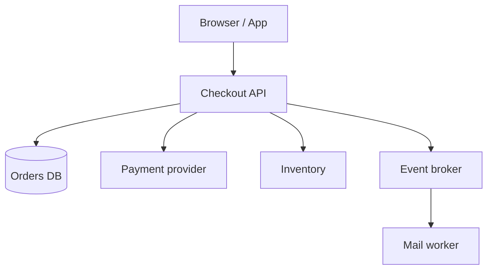

# 観点4 integration・E2E・運用

> Testing Frameworks Handbook のNotebookLM取り込み用バンドル。
> 生成元: https://github.com/hjosugi/testing-lab （scripts/build-notebooklm.sh で再生成）

---

<!-- SOURCE: docs/20-integration-testing-deep-dive.md -->

# Integration testing完全ガイド

## 一言で

Integration testingは、本物の境界を使って「接続・変換・設定・実装差」が正しいか確認するテストです。

## なぜUnit testだけでは足りないか

Unit testがgreenでも次は壊れます。

- SQL column名が違う
- transaction isolationが想定と違う
- JSON enumの大文字小文字が違う
- HTTP timeoutが設定されていない
- Kafka keyがなくorderingが崩れる
- timezone/encoding/localeが違う
- dependency injection wiringが誤る
- TLS/certificate/DNS/proxyが違う

## Integration testの5つの形

### 1. In-process integration

framework/router/serializer/DI containerなどを本物で動かします。外部processはfakeでも構いません。

### 2. Process-to-process integration

application processとDB/broker/mock serverをnetwork越しに動かします。

### 3. Service integration

複数の自社serviceを起動します。

### 4. Third-party sandbox integration

payment/email/cloudなどvendor sandboxを使います。

### 5. Production connectivity smoke

実production dependencyとの最小安全操作を確認します。

これらを同じ`integration` directoryへ混ぜるとruntimeとownershipが分からなくなります。

## Database integration

### 必ず本番と同じengineを使うrisk

in-memory DBでは次が異なる可能性があります。

- SQL dialect
- collation/case sensitivity
- timestamp/decimal
- locking/isolation
- index/query planner
- constraint timing
- JSON/array/type
- extension

### Testcontainersの使い方

```text
immutable image digest
random host port
readiness condition
production migration適用
unique database/schema per worker
automatic cleanup
failure logs保存
```

container reuseで速度を上げる場合もtest data isolationを保ちます。

### Transaction rollback pattern

各testをtransactionで囲みrollbackすると速いですが、次を隠す可能性があります。

- commit hook
- after-commit event
- real transaction boundary
- multiple connection visibility
- deadlock

rollback testとcommit integration testを分けます。

### Repository contract suite

同じbehavior suiteをin-memoryとreal DBへ実行します。

```text
saves and reloads
rejects duplicate id
optimistic version conflict
preserves decimal/timezone
pagination ordering stable
```

fakeがcontractを満たしても性能/query planは保証しません。

実行例は[Python real Postgres lab](../labs/python/README.md#real-postgres-integration)にあります。同じ3-case contractをin-memory/real adapterへ流し、engine固有のrollback、row lock、unique constraint、UTC、readiness、cleanupは別suiteに分けています。

### Migration test

```text
empty -> latest
previous supported -> latest
large representative data -> latest
interrupted migration -> resume
mixed old/new application -> compatible phase
rollback where supported
```

schema diffだけでなくdata transformationを照合します。

## HTTP integration

### Server-side

- route/method
- content type/negotiation
- validation
- authentication/authorization filter
- error mapping
- body/header limit
- cancellation/disconnect
- compression
- observability context

### Client-side

- base URL/path/query encoding
- headers/auth/idempotency key
- serialization/deserialization
- timeout/deadline
- retry policy
- error classification
- connection pooling
- proxy/TLS where necessary

### Mock HTTP serverの限界

WireMock/mountebank等はwire-level requestを確認できますが、real vendorのTLS、rate limit、undocumented behavior、eventual consistencyは保証しません。少数sandbox smokeで補います。

## Messaging integration

### 確認するもの

- topic/queue/exchange name
- serializer/schema
- partition key
- ordering scope
- ack/nack
- retry/backoff
- dead-letter routing
- duplicate handling
- consumer group/rebalance
- tracing headers
- large message limit

### At-least-onceを前提にする

```text
publish succeeded but ack lost
consumer processed but offset commit failed
redelivery after timeout
```

duplicateはexceptionではなく通常failure modeとしてtestします。

### Async assertion

fixed sleepではなくdeadline内のconditionをpollします。

```text
await until order status == CONFIRMED
deadline 10s
poll 100ms with backoff
on timeout dump consumer lag, DLQ, trace
```

## Filesystem integration

- path separator/case sensitivity
- atomic rename
- permission
- disk full/quota
- concurrent writer
- symlink/traversal
- encoding/newline
- large file/partial write
- cleanup after crash

temporary directoryはtestごとに固有にし、current working directoryへ依存しません。

## Cache integration

- serialization/version
- TTL/expiry
- eviction
- stampede
- key collision/tenant prefix
- unavailable cache fallback
- consistency with source of truth
- cluster behavior

local map fakeではTTL、eviction、network、cluster behaviorが消えます。

## Search engine integration

- analyzer/tokenizer
- mapping
- refresh/eventual visibility
- pagination/search-after
- relevance fixtures
- alias/index migration
- partial failure

exact rankingを固定しすぎるとengine upgradeで壊れます。business-critical orderと許容差を分けます。

## Object storage integration

- multipart upload
- checksum
- metadata/content type
- range request
- eventual consistency assumption
- signed URL expiry
- permission/encryption
- cleanup/versioning

emulatorとmanaged serviceの差を少数cloud testで確認します。

## Email integration

local capture serverで次を確認します。

- envelope/from/to
- MIME/HTML/text
- attachment
- charset
- link correctness
- no PII leak

deliverability、SPF/DKIM/DMARCはseparate environment/monitoringが必要です。

## Identity provider integration

- OIDC discovery/JWKS rotation
- issuer/audience
- expiry/clock skew
- redirect URI/cookie/SameSite
- role/claim mapping
- logout/revocation
- key rotation

JWT library Unit testだけではconfiguration errorを検出できません。

## Cloud emulator integration

LocalStack/Azurite等は高速ですが、完全互換ではありません。

三層にします。

1. fake: domain/application test
2. emulator/container: protocol integration
3. real cloud sandbox: managed behavior smoke

## Shared environmentの問題

- test data collision
- deployment race
- stale service version
- hidden manual configuration
- quota/rate limit
- non-repeatable external state
- ownership不明

可能ならephemeral environment、難しければnamespace、unique identifiers、environment version manifestを使います。

## Parallel execution

resourceをworkerごとに分けます。

```text
database/schema: test_<worker>
topic: orders_<run_id>
tenant: test-<run_id>-<worker>
port: OS-assigned 0
filesystem: unique temp dir
```

global cleanupで他workerのdataを消さないよう、作成したresourceだけを追跡します。

## Cleanup failure

cleanupはtest success/failureに関わらず実行します。ただしcleanup failureをsilent ignoreするとleakを隠します。

- primary test failureとcleanup failureを両方記録
- TTL/tag-based janitor
- budget/quota alert
- destructive cleanup scope guard

## Integration test speed

改善順:

1. 不要なfull contextを削る
2. dependency bootをsuite単位で共有しdataを分離
3. migration/image cache
4. parallelization
5. affected-test selection
6. contract/componentへ下げられる重複を削る

mockへ置き換えるだけでintegration coverageを失わないようにします。

## Failure diagnosis

保存するevidence:

- application/dependency version
- configuration checksum
- request/response redacted
- DB/broker logs
- migration version
- container health
- trace/span IDs
- seed/run/worker IDs

## Integration test checklist

- [ ] 対象boundaryをtest名へ書いた
- [ ] productionと同じprotocol/engine/versionか
- [ ] image/version/digestを固定
- [ ] readinessはport openだけで十分か
- [ ] data isolation/parallel safety
- [ ] commit/async behaviorをrollbackで隠していないか
- [ ] duplicate/timeout/partial failureを含むか
- [ ] cleanup/leak detection
- [ ] fake/emulator/real serviceのgapを記録
- [ ] failure時のlogs/tracesを保存

---

<!-- SOURCE: docs/21-e2e-and-acceptance-deep-dive.md -->

# E2E・Acceptance・BDD完全ガイド

## E2Eの目的

E2E testはsystem全体のすべてのruleを確認するためではありません。重要な利用者journeyが、deployされた構成とreal interfaceを通って完了できることを確認します。

## Journeyの選び方

優先するもの:

- revenue-critical
- legal/compliance-critical
- high-frequency
- integration-heavy
- past incidents
- lower levelで再現できないbrowser/device behavior

ECサイト例:

1. guest purchase
2. authenticated purchase with saved payment
3. declined payment recovery
4. refund by support agent
5. password reset

色違い・数量違いの全組み合わせは下位層へ移します。

## E2E test design card

```yaml
journey: guest checkout
persona: unauthenticated customer
entry: browser
real: web, order service, database
controlled: payment sandbox, email capture
outcome: order confirmed and receipt visible
cleanup: tagged order deleted by API
timeout: 30s
diagnostics: trace, screenshot, network log
```

## Selector strategy

優先順:

1. role + accessible name
2. label
3. visible text
4. stable product-specific test id
5. CSS/XPath as last resort

`div:nth-child(3)`やgenerated classへ依存しません。

## Waiting

悪い例:

```js
await page.waitForTimeout(5000)
```

よい例:

```js
await expect(page.getByRole('status')).toHaveText('Confirmed')
```

network idleも万能ではありません。long polling/analyticsでidleにならない場合があります。user-visible conditionを待ちます。

## Test data

### API seeding

UIで前提dataを作らず、API/admin fixtureで高速に用意します。ただしjourney自体がdata creationならUIを通します。

### Unique identifiers

```text
e2e-<run>-<worker>-<test>
```

### Cleanup

- test-created resourceにtag
- API delete
- TTL janitor
- failureでもcleanup
- evidence保存後cleanup

## Authentication

loginを全testで繰り返さず、storage state/session fixtureを使えます。ただしlogin journey自体は別にE2Eします。

session reuseでは次を確認します。

- expiration
- parallel account collision
- role/tenant isolation
- secret storage

## Network control

browser network interceptionは、frontend behaviorを安定して確認するcomponent/browser testに有効です。system E2Eでbackendまでmockすると、E2Eの意味が変わります。test名とlayerを変更します。

## Browser matrix

毎PRですべてを回す必要はありません。

```text
PR: primary browser critical journeys
merge: Chromium + Firefox + WebKit
nightly: OS/device/locale matrix
release: supported matrix + visual/a11y
```

usage data、contract、past defectsからmatrixを選びます。

## Mobile E2E

### Emulator/simulator

速く自動化しやすい一方、camera、push、biometric、performance、vendor OS差は限定的です。

### Real device

hardware/OS integrationを確認できますが、調達、reset、parallel、failure artifactが難しくなります。

### Gray-box

Detox/EarlGrey/Espresso等はapp内部のidle/synchronization情報を利用し、black-boxより安定させます。

WebDriver、gray-box、image recognitionをemulator/real deviceと混同せず、
OS/device/input/networkをrisk-basedに削減する具体例は
[Mobile／desktop／game／device matrix設計](32-mobile-desktop-game-device-matrix.md)
を参照してください。device farm/HILにはartifact、owner、予約、resetを含む
execution contractが必要です。

## Visual testing

### Pixel diff

完全pixel一致。deterministic renderが必要です。

### Perceptual diff

人が気づく差へ近づけますが、threshold tuningが必要です。

### DOM/structure snapshot

見た目を完全には保証しません。

固定するもの:

- browser/version
- OS/font
- viewport/DPR
- animation
- time/random/data
- color mode/locale

baseline更新にはreviewerと理由が必要です。

## Accessibility testing

自動ruleで見つけられるもの:

- missing accessible name
- contrastの一部
- invalid ARIA
- form label
- heading structureの一部

自動では不十分なもの:

- keyboard journey usability
- screen reader announcement quality
- focus order meaning
- cognitive load
- voice control
- meaningful alternative text

自動 + keyboard + screen reader + user testingを組み合わせます。

## Acceptance testing

Acceptance testは「利用者が受け入れられる完成条件」を検証します。UI automationと同義ではありません。

API level acceptance:

```text
Given customer has valid cart
When checkout command is submitted
Then confirmed order is returned
```

UI level acceptance:

```text
Given customer is on checkout page
When payment is submitted
Then confirmation is visible
```

最も安定して意味を伝えられるlevelを選びます。

## ATDD

実装前にproduct/QA/engineeringがacceptance exampleを合意します。

流れ:

1. story/ruleを説明
2. examplesとcounterexamples
3. unanswered questions
4. acceptance criteria
5. automation levelを選択
6. implementation

## BDD

BDDはGiven-When-Then syntaxではなく、exampleを使ってbehaviorを発見し共通言語を作る活動です。

### Discovery

Example Mapping:

- yellow: story
- blue: rule
- green: example
- red: question

### Formulation

business-readable exampleへ整理します。

### Automation

必要なexampleだけを適切なlayerで自動化します。

## Gherkinのよい例

```gherkin
Rule: A declined payment must not create a confirmed order

Scenario: Card is declined before capture
  Given a cart total of 1200 yen
  And the payment provider will decline the card
  When the customer checks out
  Then the checkout is rejected as payment declined
  And no confirmed order exists
```

## Gherkinの悪い例

```gherkin
When I click #submit-button
And I wait 5 seconds
Then div.result:nth-child(2) contains OK
```

これはbusiness specificationではなく脆いUI scriptです。

## Specification by Example

ruleと具体例をliving documentationとして維持します。

重要:

- exampleはruleを説明
- edge/counterexample
- automationとdocumentのsingle source
- obsolete scenarioのretirement
- stakeholderが読める語彙

## Exploratory testingとの関係

scripted acceptanceは既知の期待を確認します。exploratory testingは未知のriskを発見します。両方必要です。

## E2E flakiness

原因:

- async wait
- shared data/account
- environment deploy race
- third-party sandbox
- browser resource shortage
- animation/network
- hidden order dependence

対策:

- condition wait
- isolated data/context
- environment version check
- trace/network/server correlation
- primary cause repair
- retry前failure metric

## Retry

retryは一時的な診断/外部不可避性の緩和に限定します。

```text
attempt 1 failureを保存
retry successをflakeとして記録
owner/issue/expiry
```

最終greenだけをreportするとtrustを壊します。

## E2E failure evidence

- trace
- screenshot at failure
- video when motion matters
- DOM/accessibility tree
- network HAR/redacted
- console errors
- server trace ID
- environment versions
- test data IDs

全部常時保存せず、privacy/cost/diagnostic valueで選びます。

## E2E checklist

- [ ] journeyがbusiness-critical
- [ ] lower layerで十分なruleを重複していない
- [ ] real/control boundaryを明示
- [ ] user-visible selector/condition
- [ ] unique data/account/context
- [ ] no fixed sleep
- [ ] deterministic clock/random where possible
- [ ] failure artifactとtrace correlation
- [ ] retry前flakeを計測
- [ ] baseline/scenarioのownerとretirement

---

<!-- SOURCE: docs/22-performance-security-resilience.md -->

# Performance・Security・Resilience

これらは「non-functional」とまとめられがちですが、設計・oracle・environmentが大きく違います。

# Part 1: Performance testing

## まずSLOを決める

```text
POST /orders
p95 < 300ms
p99 < 800ms
error rate < 0.1%
at 500 requests/sec
with 10k active customers
for 30 minutes
```

「速いこと」だけではtestできません。

## Microbenchmark

function/algorithmの小さな性能を測ります。

注意:

- JIT warm-up
- dead-code elimination
- constant folding
- CPU frequency/noise
- GC/allocation
- statistical comparison

unit test内でwall clockを測り`< 10ms`とassertするのは不安定です。専用benchmark harnessを使います。

## Component benchmark

serializer、query、cache、business componentなどをdependency込みで測ります。

## Load test

想定通常負荷でSLOを満たすか確認します。

workload model:

- operation mix
- arrival rate vs closed users
- think time
- data cardinality
- cache warm/cold
- read/write ratio
- auth/session

## Stress test

負荷を限界以上へ上げ、bottleneckとdegradationを確認します。

見るもの:

- saturation point
- error type
- queue growth
- timeout propagation
- recovery after load removal
- data correctness

## Spike test

急激な負荷変化を与えます。autoscaling起動時間、connection storm、cache stampedeを確認します。

## Soak/endurance test

長時間実行で次を探します。

- memory/thread/file descriptor leak
- connection leak
- queue/lag accumulation
- log/disk growth
- cache fragmentation
- scheduled task overlap

## Capacity test

安全に提供できる最大traffic/data/tenantを求めます。限界ぎりぎりをproduction capacityにせずheadroomを持ちます。

## Scalability test

resourceを増やしたときにthroughput/latencyがどう変化するか測ります。

- vertical
- horizontal
- partition/shard
- hot key
- coordination overhead

## Volume test

大量data sizeでquery、index、memory、backup、migrationが機能するか確認します。request rateとは別です。

## Latency injection test

dependency latencyがtailへどう伝播するか確認します。averageだけでなくp99とdeadline budgetを見ます。

## Coordinated omission

systemが遅い間にload generatorがrequestを送らなくなると、遅延を過小評価します。arrival-rate modelとtool behaviorを確認します。

## Performance correctness

高速でもresponse/drop/dataが誤っていれば失敗です。

- response validation sampling
- no lost/duplicate writes
- final state reconciliation
- error classification

## Baselineとregression

hardware/cloud noiseを考慮し、confidence interval、effect size、複数runを使います。小さい変化を毎回failさせるとnoiseになります。

# Part 2: Security testing

## Threat modelから始める

asset、actor、entry point、trust boundary、abuse caseを整理します。

```text
Asset: order/payment/customer PII
Actor: anonymous/customer/support/admin/vendor
Boundary: browser/API/service/DB/third-party
Abuse: IDOR, privilege escalation, replay, injection, exfiltration
```

## SAST

source/bytecodeのpattern/data flowを分析します。

長所:

- early/fast
- code location

限界:

- runtime configuration
- business authorization
- false positive/negative

## SCA

dependency、license、known vulnerabilityを確認します。

- direct/transitive
- runtime reachability
- exploitability
- lockfile/SBOM
- fix availability
- exception expiry

## DAST

running applicationへ外部からprobeします。authentication/seed/cleanupを設計し、productionへ破壊的scanを送らないようscopeを固定します。

## IAST/RASP-assisted test

runtime instrumentationを用いてsource/sinkを観測します。environment overheadとcoverage範囲を理解します。

## Authentication tests

- invalid/expired/revoked token
- issuer/audience/signature
- session fixation
- CSRF
- logout/invalidation
- MFA recovery
- password reset enumeration
- clock skew/key rotation

## Authorization tests

role matrixだけでなくresource ownership/tenantを確認します。

```text
actor x action x resource owner x state
```

deny-by-default、horizontal/vertical privilege escalationをtestします。

## Injection tests

- SQL/NoSQL/LDAP/OS command
- template
- header/CRLF
- log injection
- prompt injection/tool injection

escapingだけでなくparameterization、allowlist、sandboxを確認します。

## Web security tests

- XSS
- CSRF
- SSRF
- request smuggling
- open redirect
- path traversal
- insecure upload
- CORS/CSP/security headers

## API security tests

- BOLA/IDOR
- mass assignment
- excessive data exposure
- rate limit/resource consumption
- inventory/version exposure
- unsafe third-party API consumption

## Cryptographic tests

- known answer vectors
- key/nonce uniqueness
- algorithm/mode policy
- rotation/backward compatibility
- invalid signature/ciphertext
- constant-time where required
- secret never logged

crypto primitive自体を自作testで証明せず、標準library + official vectorを使います。

## Fuzz/security testing

parser/protocolへsanitizer付きfuzzを行い、crashだけでなくresource exhaustion、state confusionを探します。

## Penetration test/red team

自動scannerが見つけにくいchain、business logic、social/operational gapを人が探索します。結果を再現testとthreat modelへ戻します。

## Supply-chain tests

- source/dependency provenance
- signed artifact
- reproducible build where possible
- SBOM
- malicious package/name confusion
- CI secret/permission
- release integrity

# Part 3: Resilience testing

## Resilienceとは

故障を防ぐだけでなく、故障中に安全にdegradeし、回復できる能力です。

## Failure modes

- fail-stop
- slow/timeout
- partial response
- stale/incorrect response
- duplicate
- reorder
- split brain
- resource exhaustion
- clock skew/jump
- operator/config error

exceptionだけをstubするtestはfailure spaceの一部です。

## Retry test

- retryable/non-retryable classification
- max attempts/deadline
- exponential backoff/jitter
- idempotency
- retry storm
- cancellation

retryでlatency budgetを超えたり、non-idempotent operationを重複実行したりしないか確認します。

## Timeout/deadline test

各hopのtimeout合計がend-to-end deadline内か確認します。timeoutはfailure発生まで待つ時間であり、適当に大きくしません。

## Circuit breaker test

- open threshold
- half-open probe
- recovery
- per-dependency isolation
- metrics/alert

## Bulkhead test

1 dependency/tenant/workloadのresource exhaustionが他へ波及しないか確認します。

## Graceful degradation

recommendationが停止してもcheckoutは動く、cache staleを表示する等、どの機能を落とせるか仕様化します。

## Fault injection test

application/component levelでcontrolled faultを注入します。deterministicでPRにも配置できます。

## Chaos experiment

production-like/productionでsystem-level hypothesisを検証します。

必須:

- steady state
- hypothesis
- blast radius
- abort condition
- observability
- rollback
- approval/owner
- learning capture

## Disaster recovery test

- region/account failure
- DNS/failover
- data replication/RPO
- restore/RTO
- key/secret availability
- runbook/personnel
- customer communication

## Game day

技術systemだけでなく人・process・communicationをtestします。inject、observe、decision、recovery、retrospectiveを行います。

## Deterministic simulation testing

time/network/disk/schedulerをsimulation runtimeで制御し、多数のfailure/scheduleをseedから再現します。

強み:

- rare interleaving
- fast/repeatable
- failure replay

コスト:

- architecture requirement
- simulator/real gap
- native/external dependency

## Cross-cutting checklist

- [ ] measurable requirement/SLO/threat/hypothesisがある
- [ ] workload/actor/failure modelが現実的
- [ ] correctnessも同時に確認
- [ ] destructive testのscope/abort/cleanup
- [ ] resultをaverage/one runだけで判断しない
- [ ] tool outputをbusiness riskへtriage
- [ ] productionとの差を明記
- [ ] learningをdesign/test/runbookへ戻す


---

<!-- SOURCE: docs/24-ci-flakiness-economics.md -->

# CI・Flakiness・テスト経済性

## 一言でいうと

テストは「多いほど良い」のではありません。**重要な欠陥を、十分早く、十分正確に、原因を追える形で知らせる情報システム**です。

## テスト1本の価値

おおまかには次で考えられます。

```text
価値 ≒ 検出する損失 × 欠陥発生確率 × 検出確率
       - 実行費用 - 保守費用 - 誤警報の損失 - feedback待ち時間
```

数式を厳密に計算する必要はありません。決済の二重請求を守る遅いintegration testは高価値ですが、色の実装詳細を固定する壊れやすいsnapshotは低価値かもしれません。

## CI laneを分ける

| lane | 目安 | 目的 | 失敗時 |
|---|---:|---|---|
| pre-commit | 数秒 | lint、型、狭いunit | commit前に直す |
| pull request | 5〜15分 | component、integration、contract | mergeを止める |
| main/post-merge | 15〜60分 | 広いmatrix、E2E、mutation差分 | mainを赤くしowner通知 |
| nightly | 時間単位 | full mutation、fuzz、soak、全browser | triage issue化 |
| pre-release | 必要時間 | migration、DR、性能、安全性 | release判定 |
| production | 継続 | canary、synthetic、SLO | rollback/mitigation |

最速のテストだけをPRへ置くのではなく、**重要なriskへ最短で到達する組合せ**を置きます。

## Flaky testとは

同じcodeと意図上同じenvironmentで、pass/failが変わるテストです。単なる「たまに失敗」ではなく、suiteの情報価値を壊します。

### 主因

- time: wall clock、timezone、期限境界
- ordering: test順、global state、shared fixture
- concurrency: race、port、file、DB row競合
- async: sleep、eventual consistency、未待機promise
- network: external service、DNS、rate limit
- randomness: seed未保存、generator不備
- resources: CPU/memory/disk不足
- UI: unstable selector、animation、network idle誤用
- environment: locale、browser、OS、dependency drift

### 直し方

1. failure artifactを残す。seed、時刻、環境、trace、log、screenshotを保存する。
2. 繰り返し実行して再現率を測る。再実行で隠さない。
3. 原因分類しownerと期限を付ける。
4. quarantineは一時措置にし、重要riskの代替testを置く。
5. 根本原因を直してからretryを減らす。

`retry=3`でgreenになったことは修正ではありません。初回fail率が1%のtestを100本走らせると、独立と仮定したsuite green率は約 `0.99^100 ≈ 36.6%` です。

## Determinismを設計する

- clockを注入し固定する
- random seedを表示・再利用する
- unique namespaceをtestごとに割り当てる
- databaseをtransaction/schema/containerで隔離する
- pollingはdeadlineと観測条件を使う
- cleanupは成功時だけでなくfinallyで行う
- parallel安全性を明示する
- external dependencyは目的に応じreal、emulator、stubを選ぶ

## Test selection

### 代表的な選択

- path/target dependency based
- changed-method/class impact analysis
- historical failure probability
- risk label based
- coverage relation based
- predictive selection

選択漏れがあるため、PRでは選択suite、main/nightlyではより広いsuiteを回します。選択器そのものもversion管理し、missを監視します。

## Parallelizationとsharding

速くするだけでなく、隔離欠陥を露出させます。

- deterministic shard keyを使う
- test durationを記録しbalanced shardにする
- shared account/tenant/portを禁止する
- shardごとのartifactを統合する
- one-time setupを競合させない

## Quarantine policy

quarantine対象には必ず次を付けます。

```text
owner / failure rate / protected risk / alternative coverage
ticket / deadline / last failure evidence / exit condition
```

quarantine suiteを誰も見ない状態は「削除していないだけ」です。

## Coverage・mutation・defect data

| 指標 | 分かること | 分からないこと |
|---|---|---|
| line/branch coverage | 実行されなかった場所 | assertionの正しさ |
| mutation score | 小さなcode変化をtestが検出する力 | 実際の全欠陥 |
| escaped defects | 現実に逃した欠陥 | 未発生risk |
| flake rate | 信頼性 | coverage |
| duration/queue time | feedback速度 | business価値 |
| change failure rate | delivery結果 | 個々のtest原因 |

単一の全社目標値にせず、risk領域・lane・変更頻度ごとに見ます。

## Failure triageを速くするartifact

- exact command、commit、dependency lock
- seed、test data identity、clock
- structured logとcorrelation ID
- request/responseの安全な要約
- DB/event state
- browser trace、screenshot、video
- performance profile
- first failureとretry履歴

機密情報・token・個人情報をartifactへ残さないredactionもtestします。

## Suiteを削除する判断

次のtestは統合・置換・削除候補です。

- 同じriskをより低いcostで別testが守る
- obsolete behaviorを固定している
- assertionがない／常にpassする
- implementation detailだけを固定する
- 修復不能なexternal dependencyへ依存する
- 長期間価値がなく、ownerも不在

テストコードもproduction codeです。追加だけでなく、refactorとretirementが必要です。

## Review checklist

- [ ] protected riskとownerが書かれている
- [ ] 最も低い有効なboundaryで検証している
- [ ] oracleが欠陥に反応する
- [ ] seed/time/data/environmentを再現できる
- [ ] failure artifactだけで初動できる
- [ ] CI laneとtimeoutが妥当
- [ ] retry/quarantineに期限がある
- [ ] suiteの価値・速度・flakeを継続計測する


---

<!-- SOURCE: docs/09-production-strategy.md -->

# 本番プロジェクトへの導入

## 90日プラン

### Day 1-14: 可視化

- test種類、実行時間、flake率、ownerを棚卸し
- production incidentをどのtest層なら防げたか分類
- critical business pathsを10個まで選ぶ
- fast laneのbaselineを保存

### Day 15-30: 境界整理

- clock/random/remote APIへ明示portを置く
- giant fixtureとglobal stateを削減
- fake contract suiteを作る
- test namingとdata builderの規約を決める

### Day 31-60: portfolio改善

- pure domainへproperty test
- service間へcontract test
- real DB integrationをephemeral化
- E2Eをcritical journeyへ整理
- flake quarantineにowner/期限を追加

### Day 61-90: 強度と運用

- high-risk moduleへmutation test
- CI lane分離
- p50/p95 test duration、flake率、escaped defectをdashboard化
- framework upgrade policyを決める

## pull request checklist

- 変更したbehaviorがtest名から分かる
- successだけでなく重要failure pathがある
- clock/random/networkが制御されている
- private implementationを不必要にverifyしていない
- parallel実行で共有resourceが衝突しない
- retryを追加する場合、原因Issueと期限がある
- integration fakeにはreal adapter contractがある
- E2E追加理由が下位層で検出できないfailureに対応する

## metrics

| Metric | 目的 | 誤用 |
|---|---|---|
| suite p50/p95 duration | feedback速度 | test数だけ削る |
| flake rate | trust | retry後greenを成功扱い |
| mutation score by risk module | assertion強度 | 全repo 100%目標 |
| escaped defects | portfolio gap | 個人評価 |
| failure diagnosis time | report品質 | logs量を増やすだけ |


---

<!-- SOURCE: docs/28-case-study-commerce.md -->

# ケーススタディ: ECサイトの完全テスト戦略

## 対象system

顧客が商品をcartへ入れ、couponを使い、在庫を確保し、外部payment providerで支払い、注文を作り、emailを受け取るsystemを考えます。



## まずriskを書く

| Risk | 影響 | 重要な性質 |
|---|---:|---|
| 二重請求 | 最大 | idempotency |
| 金額誤り | 最大 | money invariant |
| 在庫だけ減る | 大 | compensation/consistency |
| 注文なしで請求 | 最大 | state transition |
| coupon濫用 | 大 | authorization/rule |
| 個人情報漏洩 | 最大 | access control/redaction |
| sale時の遅延 | 大 | capacity/latency |
| checkout不能 | 大 | availability/degradation |

テスト数ではなく、このrisk tableをcoverageします。

## Domain unit tests

### 対象

- subtotal/tax/discount/rounding
- coupon eligibility
- order state machine
- retry/idempotency key generation

### 例

```text
Given 1000円の商品2点と10% coupon
When totalを計算
Then subtotal=2000, discount=200, payable=1800
```

さらにpropertyとして、`payable >= 0`、item順序でtotal不変、同一coupon二重適用不可を確認します。

## Classical component test

in-memory fake repository/payment gatewayを使い、checkout use case全体をstateで確認します。

```text
When checkout succeeds
Then order is PAID
And exactly one charge record exists
And outbox contains OrderPaid
```

内部methodの呼出順ではなく、公開結果を守ります。

## London interaction test

外部payment commandのprotocolが重要なadapterではinteractionを確認します。

```text
charge(amount=1800, currency=JPY, idempotencyKey=order-42)
```

金額、通貨、idempotency keyは契約の一部です。一方、private helperの呼出順は固定しません。

## Database integration

本物のengineで次を確認します。

- unique idempotency key
- money precision/scale
- transaction rollback
- outboxとorderのatomic write
- migration up/old-data compatibility
- concurrent checkout conflict
- query/index performance

in-memory DBだけではengine固有のlock、constraint、SQLを守れません。

## Payment contract test

consumer側が実際に使うrequest/response、error、timeout、webhook signatureを契約化します。

- amount/currency shape
- idempotency semantics
- declined/temporary failure mapping
- unknown field compatibility
- webhook replay

contract greenでもproviderの本番networkや資格情報は保証しないためsandbox smokeも残します。

## Messaging integration

at-least-once deliveryを前提にします。

- duplicate `OrderPaid`でもemailは一通
- out-of-order eventを安全に扱う
- consumer crash後redelivery
- poison message/DLQ
- schema evolution
- observability: message/order correlation

「publish methodを1回呼んだ」だけではbroker integrationを検証できません。

## API tests

### Schema/contract

status、JSON shape、required field、error formatを確認します。

### Behavior

- unauthorized/forbidden
- invalid coupon
- out-of-stock
- payment decline/timeout
- duplicate request
- rate limit
- locale/currency

### Property/fuzz

OpenAPI schemaからinvalid/edge inputを生成し、5xx、information leak、hangを探します。

## UI component tests

- cart quantity keyboard操作
- error message association
- loading/disabled state
- currency/locale rendering
- responsive layout
- screen reader name/role/value

network responseはcontrolled fakeにし、UI stateを高速に網羅します。

## E2E journeys

少数の価値あるjourneyだけにします。

1. standard checkout
2. payment declined then retry
3. duplicate submitでも一回だけ請求
4. expired inventory/coupon
5. keyboard/screen-reader critical path

stable role/label selector、condition-based wait、APIによるtest data setup、unique user/orderを使います。

## Acceptance / ATDD

product、engineering、QA、operationsがexampleを作ります。

```gherkin
Scenario: 通信timeout後の再送で二重請求しない
  Given 注文42の最初の決済結果をclientが受信できない
  When 顧客が同じ注文を再送する
  Then 顧客への請求は1800円の1件だけである
  And 注文42は支払済みである
```

これはUI scriptの書式ではなく、business ruleの共同理解です。

## Performance

SLO例:

```text
steady 500 checkout/s
p95 < 400ms, p99 < 900ms
error < 0.1%
sale spike 3x for 10min
```

load、spike、soakを分け、結果の正しさ、queue lag、DB lock、provider rate limit、autoscalingも観測します。

## Security

- user Aがuser Bのorderを読めない
- coupon/admin endpointのauthorization
- priceをclient inputから信用しない
- webhook signature/replay window
- PII/tokenをlog/reportへ出さない
- dependency/container/IaC scan
- abuse rate limitとbot scenario

## Resilience / chaos

- payment timeout/late success
- inventory partial outage
- broker unavailable
- DB failover/connection exhaustion
- email outageはcheckoutを止めない
- region outage/restore

定常状態、注入fault、期待degradation、abort conditionを先に決めます。

## Data/analytics

- orders totalとpayment settlement reconciliation
- refund/tax/currency consistency
- duplicate/missing event
- daily partition/timezone
- PII retention/deletion

## Production verification

- post-deploy smoke
- canary error/latency/business KPI
- synthetic checkoutは実請求しない専用route/account
- shadow requestは副作用を抑止
- rollback条件
- SLO/incidentからregression test追加

## CI配置

| Lane | 内容 |
|---|---|
| local | domain、component、type/lint |
| PR | DB integration、contract、API、UI component、少数E2E |
| main | 全integration、browser matrix、mutation差分 |
| nightly | fuzz、full mutation、security、soak subset |
| release | migration、capacity、DR、sandbox provider |
| production | canary、synthetic、SLO |

## Traceability matrix

| Risk | 主test | 補助test | Production signal |
|---|---|---|---|
| 二重請求 | property/state model、concurrency DB | E2E duplicate submit | duplicate charge alarm |
| 金額誤り | domain property、differential | API/E2E | reconciliation |
| payment不整合 | component、contract、fault injection | sandbox smoke | settlement mismatch |
| 遅延 | load/spike/soak | microbenchmark | p95/p99/SLO |
| PII漏洩 | authorization/security | E2E | audit/DLP alert |

## 完了条件

- [ ] 全critical riskにowner、test、production signalがある
- [ ] money/idempotencyはexampleだけでなくproperty/state/concurrencyで守る
- [ ] real DB/broker/provider contractの境界がある
- [ ] E2Eは重要journeyへ限定しartifactが十分
- [ ] migration、performance、security、resilience、DRをrelease計画に含める
- [ ] incidentをregressionへ戻すloopがある


---

<!-- SOURCE: docs/32-mobile-desktop-game-device-matrix.md -->

# Mobile／desktop／game／device matrix設計

更新日: 2026-07-19

この章は、mobile app、desktop app、game、embedded deviceを同じ「UI test」
という箱へ入れず、automation mechanism、execution substrate、risk、artifact、
hardware運用を分けて設計します。copy可能な雛形は
[device test plan template](../templates/device-test-plan.md)、機械検証するreference
planは[device matrix JSON](../templates/device-test-matrix.example.json)です。

## 最初に分ける2軸

`emulatorでAppiumを使う`という1文には、別の判断が2つ含まれます。

1. **automation mechanism**: testがappをどう操作・観測するか
2. **execution substrate**: appをどの実行環境に載せるか

| 分類 | 意味 | 代表例 | 主に見えるもの | 主に見えないもの |
|---|---|---|---|---|
| WebDriver | HTTP protocol越しのblack-box automation | Appium 3 + platform driver | accessibility/UI hierarchy、platform driverが公開する操作 | app内部idle、未公開state |
| native UI API | platform標準のUI automation | XCUITest | Apple UI surface、system alert、accessibility element | cross-platform共通protocol、app内部state |
| gray-box | test build内のinstrumentationとhost runnerを協調 | Detox、EarlGrey 2、Espresso | idle/synchronization、application element、native action | production binaryそのもの、未instrumentationの外部app |
| in-app hooks | app component treeへtest hookを組み込む | Cavy、Flutter `integration_test` | component/widgetとapplication flow | native system UI、他application |
| hierarchy inspection | engine/platformのsemantic treeを読む | Poco | object/control ID、properties、engine hierarchy | treeに出ないrendered pixel |
| image recognition | screenshot templateから位置を認識 | Airtest | semantic treeがないrender surface | control identity、hidden state、意味 |
| hardware protocol | electrical/bus/sensor signalを注入・観測 | custom HIL runner | timing、sensor、bus、safety interlock | 人が見るUIだけのquality |

simulator、emulator、real device、HILはこの表のmechanismではありません。
例えばAppiumはemulatorでもreal deviceでも使えます。Airtestもreal game deviceや
Windows appへ使えます。`emulation`をWebDriverやgray-boxと並べてtool分類に
しないことが、責務混同を防ぐ最初のgateです。

## Surface別tool decision

| Tool | Surface | Mechanism | 強み | 採用判断 |
|---|---|---|---|---|
| Appium 3 | iOS、Android、desktop、driverがあるplatform | W3C WebDriver client/server | languageとplatformを跨ぐblack-box journey、device farm接続 | cross-platform smokeとsystem UIを含む少数journeyへ採用。server、client、driver、pluginを別々にpinする |
| Detox | React Native iOS/Android | gray-box | RN JS/native thread、network、layout、timer、animation等とのautomatic synchronization、device/artifact管理 | RN critical journeyのdefault。対応RN/device matrixをupgrade時に再確認 |
| XCUITest | native iOS | Apple native UI API | simulator/real device、system alert、accessibility UI、`.xcresult`とattachment | iOS platform default |
| EarlGrey 2 | native iOS | XCUITest + gray/white-box synchronization | animation、queue、network idle、RMIによるwhite-box補助 | plain XCUITestで同期不足が実測された範囲だけpilot。branch/build integration costを測る |
| Espresso | native Android | instrumentation gray-box | message queue、task、IdlingResourceとの同期、fast in-app UI action | Android native appのdefault。外部app/system surfaceはUiAutomator/Appiumへ分離 |
| Airtest | game、native app、Windows | image recognition | semantic hierarchyがないrendered UIにも適用可能 | hierarchyが取れない最後のfallback。template、resolution、locale、animationをversion管理 |
| Poco | Unity、Cocos、UE等のgame、native mobile | hierarchy inspection | engine UI tree、stable control path、property観測 | gameはPocoをAirtestより先に選ぶ。engine buildへPoco SDKを組み込む契約を持つ |
| Cavy | React Native | in-app refs/test hooks | pure JSのtargeted integration、deep componentへのhook | pilot候補。hook maintenanceを測り、system UI/black-box coverageの代替にしない |
| Flutter `integration_test` | Flutter mobile/desktop/web | in-app widget/application integration | official SDK package、physical device/emulator、`flutter_test` style | Flutter application journeyのdefault。native permission/share sheet等はXCUITest/Espresso/Appiumで補う |

Appiumはtest frameworkそのものではなくautomation serverです。test runner、
fixture、assertion、reporter、oracleを別に選びます。またAppium 3のdriver/pluginは
core serverから分離されるため、`appium`のversionだけを記録しても再現できません。

Detox、EarlGrey、Espressoの「同期」はsleepを短くする機能ではありません。
frameworkが把握するidle conditionと、applicationが実際にbusyである条件が一致する
場合にだけ有効です。long polling、untracked native work、animation loopは明示的な
idle resource、blacklist、test hook、または設計変更が必要です。

Airtestの画像認識とPocoのhierarchy inspectionも同義ではありません。Pocoでstable
object IDを得られるならそれをprimary locatorにし、画像はtreeに現れないcanvas、
shader、sprite、render corruptionのoracleに限定します。

## React NativeとFlutterのdefault

### React Native

```text
component behavior       React Native Testing Library等
in-app integration pilot Cavy
critical E2E             Detox
system UI / farm black-box Appium or platform-native UI tool
```

Detoxはhostのtester、appへ組み込むnative client、mediatorから成り、RNとnative
operationのidle情報を使います。CavyはReact refs/test hooksをappへ追加してcomponent
を操作します。したがってCavyは小さなin-app integrationには使えても、permission
dialog、他app、production binaryと同じblack-box surfaceを保証しません。

Cavyを採用する前に、対象RN version、New Architecture、test hook差分、CI exit code、
artifact、project activityを小さなpilotで確認します。defaultをDetoxからCavyへ
一括変更しません。

### Flutter

`integration_test`はFlutter SDKのofficial packageで、physical deviceとemulatorへ
application integration testを実行できます。一方、official docsが明記する通り
native platform UIは操作できません。

```text
widget/component          flutter_test
application journey      integration_test
permission/share/system  XCUITest / Espresso / Appium
vendor hardware          real device / HIL上のplatform tool
```

## Execution substrateの責務

| Substrate | 使うlane | 検出するrisk | passしても保証しないこと |
|---|---|---|---|
| iOS Simulator | PR、nightly | iOS API、screen size、locale、basic lifecycle、XCUITest/Detox flow | camera/biometric/radio/GPU/thermal、real signing、device-only entitlement |
| Android Emulator | PR、nightly | API level、form factor、rotation、config change、network/sensor simulation、Espresso/Appium flow | vendor HAL/OS差、actual memory/thermal/radio/camera性能 |
| cloud real device | release、scheduled | vendor device/OS、physical sensor/radio/GPU、real installation | local peripheral、providerが公開しないsensor、再現可能なqueue/thermal状態 |
| local real device | release、reserved | USB/Bluetooth/peripheral、offline、special account、local network | fleet全体のdevice diversity、自動resetの完全性 |
| HIL | reserved hardware | firmware、electrical signal、bus timing、sensor/actuator、safety interlock | production field environment全体、人間の長期使用 |

Android Emulatorは多くのdevice/API/sensor/network条件を高いfidelityで扱えますが、
real deviceと同一ではありません。Apple Simulatorも実機hardwareの証明には
使いません。virtual substrateを「偽物だから無価値」、real deviceを「本物だから
完全」と扱わず、検出したいfailureから配置します。

HILは単なるreal device laneではありません。product hardware/firmwareへrigから
電気信号、sensor値、bus frame、faultを注入し、timing、telemetry、actuator、
safety interlockを観測します。rig calibrationとfixture integrityがtest oracleの
一部です。

## Cartesian productを作らない

reference planは次のdimensionを宣言します。

- OS: current、minimum、platform/runtime固有
- device class: primary、小型、low-memory、tablet、desktop、game、HIL
- input: touch、biometric、camera、keyboard/mouse、gamepad、sensor
- network: normal、constrained、offline/resume、lossy cellular、LAN、hardware bus

単純な直積は`7 × 7 × 6 × 6 = 1764` cellsです。reference planは12 cellsだけを
選び、validatorが全dimension value、全substrate、必須mechanism、hardware riskを
少なくとも1回coverすることを確認します。

選定手順:

1. unsupported/不可能な組み合わせをconstraintで除く。
2. 各critical journeyにusage-leading OS/device/input/networkのprimary cellを置く。
3. minimum supported OS、small/large/low-resource、offline/resumeを追加する。
4. camera、biometric、radio、GPU、gamepad、sensor、bus等、virtualで証明できない
   riskをreal device/HILへ置く。
5. escaped defect、今回変更したboundary、vendor固有差をregression cellとして足す。
6. 残る低risk dimension interactionだけをpairwise/covering arrayで補う。
7. PR/nightly/release/hardwareのbudgetへ配置し、落としたcellのresidual riskとownerを
   release recordに残す。

usage shareだけでminimum OSを消さず、supported contractだけでrare hardwareを
全組み合わせに増やしません。最低1つのcellを置く条件は、利用率、重大incident、
変更量、platform固有API、hardware couplingのいずれかで説明します。

reference selection:

| Scenario | Lane | Substrate | Tool | 主risk |
|---|---|---|---|---|
| `rn-ios-primary-pr` | PR | simulator | Detox | RN critical journey/synchronization |
| `android-native-primary-pr` | PR | emulator | Espresso | Android instrumentation |
| `ios-minimum-nightly` | nightly | simulator | XCUITest + EarlGrey 2 pilot | minimum OS、offline resume |
| `android-low-memory-nightly` | nightly | emulator | Appium 3 | low memory、minimum OS、black-box contract |
| `flutter-tablet-nightly` | nightly | emulator | `integration_test` | Flutter/large screen |
| `rn-cavy-pilot-nightly` | nightly | emulator | Cavy pilot | hook cost/in-app integration |
| `android-vendor-farm-release` | release | cloud real device | Appium 3 | vendor OS、physical install、farm compatibility |
| `ios-biometric-real-release` | release | real device | XCUITest | biometric、radio、entitlement |
| `android-camera-vendor-release` | release | real device | Appium 3 | camera、vendor OS、process death |
| `windows-keyboard-release` | release | real machine | Appium 3 | keyboard/window/install |
| `unity-game-device-hardware` | hardware | real device | Poco + Airtest fallback | engine hierarchy、render、gamepad |
| `embedded-sensor-hil` | hardware | HIL | rig protocol | calibration、timing、safety |

## Artifact contract

device testのfailureをrerunだけで処理しません。すべてのartifactを
`artifacts/{runId}/{scenarioId}/{attempt}/`へ関連付けます。

| Artifact | Local virtual | Real device / farm | HIL |
|---|---|---|---|
| normalized result/JUnit + runner log | always | always | always |
| device metadata: model、OS、build、locale、input、network、provider capacity | always | always | always |
| device/system log: logcat、`.xcresult` log、crash、sysdiagnose等 | failure | always | always |
| screenshot | failure | failure | failure |
| video | failure | failure when supported | failure |
| semantic hierarchy / XCTest attachment / instrumentation output | mechanism別 | mechanism別 | optional |
| rig telemetry、bus trace、calibration | no | no | always/failure |

Detoxはlog、screenshot、video等のartifact pluginを持ちます。XCTestはscreenshotや
fileをattachmentとしてresultへ保存でき、`xcodebuild`の`.xcresult`はtest result、
coverage、log等を持ちます。Firebase Test Labはresult、video、screenshot、logを
Cloud Storageへ保存できます。

provider capabilityは変わるため、`video`を無条件に存在すると仮定しません。例えば
2026-07-19時点のFirebase Test LabはiOS 18以上でresult videoを提供しないと
明記しています。この場合はcapability metadataと理由をmanifestへ記録し、timed
screenshot、`.xcresult`/provider result bundle、device logをfallbackとして
必須にします。artifactの無言欠落をgreenにしません。

retention default:

- passed: 7日
- failed/flaky/inconclusive: 30日
- release/hardware incident: 90日以上またはrelease retention policy

credential、token、personal data、unrelated notificationはupload前にredactします。
synthetic accountを使い、run後にapp data、account session、download、mediaを
resetします。test retryとprovider/device infrastructure retryを別attemptとして
記録します。

## Hardware ownerと予約手順

hardware必須scenarioはtest ownerだけでなく、reservation procedureとlab ownerを
持ちます。role名だけで放置せず、実案件ではon-call/queue/calendarへ解決できるIDを
設定します。

### Device farm queue

Owner: Quality Infrastructure

1. provider catalogのcapacity、reduced stability、deprecationを確認する。
2. scenario、model、OS、build SHA、data classification、time budgetをsubmitする。
3. provider matrix ID、queue time、result bucketをrelease recordへ先に記録する。
4. abandoned releaseのqueueをcancelし、reasonをlinkする。
5. result URLとartifact manifestをreleaseへ添付する。

### Manual device lab / HIL

Owner: Quality InfrastructureまたはHardware Lab

1. 原則24時間前までにscenario、device/rig ID、build SHA、operator、time window、
   firmware/peripheral/network、data classification、abort thresholdをrequestする。
2. lab ownerがexclusive lease IDとpreflight stateを割り当てるまで実行しない。
3. OS/firmware、battery、thermal、calibration、cable、network、fixture stateを
   run前に記録する。
4. safety、thermal、battery、privacy、fixture integrity alarmで即時stopし、
   escalation ownerへ通知する。testを通すためinterlockを無効化しない。
5. artifactをuploadし、credential/app dataを消し、cable/network/fixtureを戻し、
   leaseをreleaseする。no-show/延長/cancelも記録する。

各hardware scenarioはapplication ownerとreservation ownerの双方を持ちます。
application ownerはoracleとrelease判断、reservation ownerはdevice/rig safety、
lease、reset、capacityを所有します。

## CI lane

```text
PR:
  primary simulator/emulator + changed critical journey
nightly:
  minimum OS + constrained/offline + form-factor/tool pilot
release:
  usage/risk selected real-device matrix
hardware:
  approved reservation + operator/lease + abort threshold
```

- test retryでflakeを隠さない。first-attempt failureをmetricへ送る。
- device unavailable、provider outage、lab safety abortはproduct failureと別分類する。
- infrastructure retryにも新しいattempt IDを付け、元failure artifactを保持する。
- device catalog、supported OS、usage、incidentを少なくとも四半期ごとにreviewする。

## Nixで固定する範囲

このhandbookにはmobile/desktop/game application binaryがないため、Appium driver、
Detox native test build、Xcode project、Android SDK image、Poco SDKを架空にinstall
しません。代わりに、reference matrixとvalidatorをrepositoryに持ち、Nixが供給する
Nodeでplan contractを検証します。

```bash
nix develop --command make verify-device-matrix
# 任意のcopyを検証
nix develop --command node scripts/verify-device-matrix.mjs path/to/plan.json
```

実application repositoryでは次を同じchangeでpinします。

- Appium server/client/driver/plugin
- Detox/Cavy npm lock、React Native version、Jest/runner
- Gradle、Android SDK/system image、Espresso、device profile
- Flutter SDKと`integration_test`
- Airtest/Poco Python lock、Poco SDK/engine build
- artifact collector、schema、retention policy

NixだけではXcode/iOS Simulatorのlicensed macOS runtime、Apple signing、physical
device、device-farm credential/capacity、USB/peripheral driver、HIL fixtureを作れません。
これらはhost/external runtimeとして明示し、Xcode/OS/device/driver/firmware/rig/
calibration/provider matrix IDをartifact metadataへ記録します。repository内の
plan validationをskipする理由にはしません。

validatorは次を拒否します。

- Appium 3、Detox、XCUITest/EarlGrey、Espresso、Airtest/Poco、Cavy、
  Flutter `integration_test`の評価漏れ
- WebDriver、gray-box、image recognition、hierarchy inspectionの分類漏れ
- `emulation`をautomation mechanismとして扱うこと
- simulator/emulator/real-device/HILのsubstrate漏れ
- full Cartesian product、未coverのdeclared dimension value
- real device/HILのowner、予約手順、artifact/video/device log漏れ
- video非対応時のfallback、retention、redaction漏れ

## Primary references

- [Appium: How Does Appium Work?](https://appium.io/docs/en/latest/intro/appium/)
- [Appium drivers](https://appium.io/docs/en/latest/ecosystem/drivers/)
- [Appium CLI: server, driver, plugin, setup](https://appium.io/docs/en/latest/reference/cli/)
- [Detox: How Detox Works](https://wix.github.io/Detox/docs/articles/how-detox-works/)
- [Detox artifacts](https://wix.github.io/Detox/docs/config/artifacts/)
- [Detox project setup and devices](https://wix.github.io/Detox/docs/introduction/project-setup/)
- [Apple: Testing in Xcode](https://developer.apple.com/documentation/xcode/testing)
- [Apple: Running tests and interpreting results](https://developer.apple.com/documentation/xcode/running-tests-and-interpreting-results)
- [Apple: Activities and attachments](https://developer.apple.com/documentation/xctest/activities-and-attachments)
- [EarlGrey 2](https://github.com/google/EarlGrey/tree/earlgrey2)
- [Android Espresso](https://developer.android.com/training/testing/espresso)
- [Android build-managed devices](https://developer.android.com/studio/test/managed-devices)
- [Airtest/Poco official documentation](https://airtest.doc.io.netease.com/en/)
- [Cavy documentation](https://cavy.app/docs/getting-started/running-tests)
- [Flutter integration tests](https://docs.flutter.dev/testing/integration-tests)
- [Firebase Test Lab](https://firebase.google.com/docs/test-lab)
- [Firebase Test Lab Android results](https://firebase.google.com/docs/test-lab/android/get-started)
- [Firebase Test Lab iOS device availability](https://firebase.google.com/docs/test-lab/ios/available-testing-devices)
