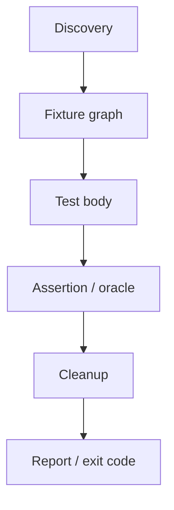

# 観点5 AI・データ・2026ツール地図

> Testing Frameworks Handbook のNotebookLM取り込み用バンドル。
> 生成元: https://github.com/hjosugi/testing-lab （scripts/build-notebooklm.sh で再生成）

---

<!-- SOURCE: docs/23-data-ml-llm-agent-testing.md -->

# Data・ML・LLM・Agent testing

# Part 1: Data testing

> 実行例: [`labs/ai-evals`](../labs/ai-evals/README.md)は、有料APIを使わずfake model・seed付き合成data・versioned datasetで、data quality（schema/null/range/unique/reconciliation、late/duplicate/out-of-order）、ML（critical slice gate、fairness、robustness、PSI drift、seed分布）、RAG（recall@kとgroundednessの分離）、LLM-as-judgeのhuman calibration（Cohen's kappa）、agentのtool schema・sandbox・prompt injection・trajectory/outcome/cost/latency分離・provenanceをtestします。

## なぜpipeline successだけでは足りないか

jobがexit 0でもdataは壊れます。

- row missing/duplicate
- wrong join
- currency scale
- timezone shift
- late event ignored
- schema meaning changed
- PII mixed
- backfill double-count

## Schema tests

- column/field presence
- type/nullability
- nested structure
- compatibility
- semantic version

schema一致は意味の一致ではありません。`amount`がcentからyenへ変わってもintegerのままです。

## Constraint tests

- not null
- unique
- range/domain
- referential integrity
- regex/format
- conditional constraint

## Distribution tests

- quantiles
- category frequency
- missing rate
- drift
- outlier
- correlation

normalなbusiness変化とdata defectを区別するthreshold/seasonalityが必要です。

## Reconciliation

source-to-targetで件数だけでなくbusiness totalを照合します。

```text
orders count
gross/net/tax/refund totals
distinct customer
checksum by partition/day
```

## Pipeline behavior

- idempotent rerun
- checkpoint/restart
- duplicate/late/out-of-order
- partial partition failure
- backfill
- schema evolution
- timezone/day boundary
- very large partition

## Data contract

producer/consumer間でschema、semantics、freshness、quality、ownershipを合意します。

```text
field: total_minor
meaning: final charged amount in currency minor unit
freshness: < 15min
null: never
owner: payments
```

## ETL unit/component/integration

- unit: transformation function
- component: in-memory/small fixture pipeline
- integration: real engine/storage/catalog
- system: source-to-warehouse
- production: freshness/volume/invariant

sample CSVだけではdistributed engine、partition、decimal、schema evolutionを確認できません。

# Part 2: ML testing

## ML systemのtest対象

- data
- feature pipeline
- training code
- model artifact
- serving code
- decision policy
- monitoring/retraining

model metricだけではsystemをtestできません。

## Data split/leakage

- train/validation/test separation
- entity/time leakage
- duplicate/near-duplicate
- future information
- label leakage

random splitが適切でないtime/entity problemがあります。

## Offline metrics

- task metric
- baseline comparison
- confidence interval
- slice metric
- calibration
- cost-sensitive error

aggregate accuracyだけでminority/critical slice failureを隠さないようにします。

## Robustness

- noise
- missing/corrupted feature
- distribution shift
- adversarial input
- out-of-domain
- abstention

## Fairness

legal/domain contextに応じてgroup/slice metric、error disparity、threshold effectを評価します。protected attributeを雑に削除してもproxy biasは残ります。

## Reproducibility

- code/data/model version
- random seeds
- environment/hardware
- hyperparameters
- feature definitions
- dataset snapshot

GPU/non-deterministic operationでbit exactが難しい場合、許容範囲とrepeatを定義します。

## Training-serving skew

同じfeature inputに対しoffline/online transformationを比較し、schema/default/time windowを確認します。

## Shadow/canary

new modelをshadowで比較し、canaryでsmall cohortへ出します。feedback loop、delayed label、policy impactを考慮します。

# Part 3: LLM application testing

## 評価対象を分解する

```text
input handling
prompt/template
retrieval
context construction
model response
post-processing
tool calls
policy/guardrail
final user outcome
```

全部をend-to-end scoreだけで評価すると原因が分かりません。

## Golden dataset

含めるもの:

- representative tasks
- difficult/edge cases
- past incidents
- safety/adversarial
- multilingual/locale
- user segments
- expected answerまたはrubric
- source/provenance

dataset自体をversion管理し、test contaminationとstalenessをreviewします。

## Deterministic tests

LLMを呼ばずに確認できるもの:

- prompt rendering
- context length/truncation
- tool schema
- parser/structured output
- policy routing
- citation mapping
- cache/key
- retry/fallback

これらは普通のUnit/contract testにします。

## Retrieval evaluation

- corpus/index correctness
- recall@k
- precision/relevance
- chunking
- metadata filter
- access control
- freshness
- answer source coverage

最終answerが良くてもunauthorized document retrievalはsecurity failureです。

## Generation evaluation

- correctness
- completeness
- groundedness/faithfulness
- relevance
- instruction following
- style/format
- citation accuracy
- uncertainty/abstention

## LLM-as-judge

judgeをcalibrateします。

```text
human-labeled sample
agreement/confusion matrix
position/order swap
model/version freeze
rubric examples
abstain/disagreement
slice analysis
```

judge prompt/model変更もtest infrastructure changeです。

## Non-determinism

- repeated trials
- pass rate/distribution
- temperature/top-p固定
- provider model version
- statistical gate
- failure sample保存

1回のpass/failで品質を断定しません。

## Prompt injection/security

- direct/indirect injection
- data exfiltration
- tool misuse
- cross-tenant retrieval
- hidden instruction
- untrusted markup/file
- output injection into downstream
- denial of wallet/resource abuse

## Cost/latency

- token/input/output
- tool calls
- cache hit
- p95/p99 latency
- retry/fallback
- budget per task

quality向上とcost/latencyをmulti-objectiveで評価します。

# Part 4: Agent testing

## Agentをstate machineとして見る

```text
Plan -> SelectTool -> CallTool -> Observe -> UpdateState -> Finish
```

各transitionとinvariantをtestします。

## Tool contract test

- schema-valid arguments
- least privilege
- timeout/cancellation
- idempotency
- error interpretation
- secret redaction
- destructive action confirmation

## Simulated environment

real serviceの前にdeterministic tool simulatorで次を注入します。

- stale result
- rate limit
- partial failure
- ambiguous success
- conflicting sources
- long sequence
- malicious content

## Trajectory vs outcome

最終answerだけでなく、必要に応じてtrajectoryも評価します。

- unnecessary calls
- unsafe call
- loop
- ignored error
- wrong recipient/resource
- budget exceeded

ただし特定の内部思考順序を固定しすぎず、observable actionとpolicyを評価します。

## Agent sandbox/security

- filesystem/network scope
- recipient/identity resolution
- external side effect approval
- prompt injection boundary
- data minimization
- audit trail
- rollback/compensation

## Multi-agent test

- task decomposition
- duplicate/conflicting action
- shared state consistency
- deadlock/livelock
- authority boundaries
- partial agent failure
- final aggregation

## Human-in-the-loop

- escalation condition
- context presented to reviewer
- approve/reject semantics
- timeout/default
- auditability
- no silent bypass

## Online evaluation

- canary cohort
- task success
- correction/undo rate
- user feedback
- safety incident
- cost/latency
- distribution shift

## AI evaluation checklist

- [ ] deterministic componentsをLLM E2Eから分離
- [ ] dataset/rubric/source/versionを管理
- [ ] aggregateだけでなくcritical slices
- [ ] judgeをhuman labelでcalibrate
- [ ] repeated trialsとdistribution
- [ ] retrieval authorization
- [ ] injection/tool misuse/secret exfiltration
- [ ] outcomeとobservable trajectory
- [ ] cost/latency/budget
- [ ] model/prompt変更をversioned releaseとして扱う


---

<!-- SOURCE: docs/15-tool-landscape-2026.md -->

# 2026 tool landscape

確認日: 2026-07-19

この表は「全部導入する一覧」ではありません。各riskに対して最小のtool setを選ぶための地図です。GitHub topicの更新時刻はactivity signalにすぎず、品質・互換性・security supportを保証しません。

## JavaScript／TypeScript core

| Tool | Category | 2026時点の位置づけ | 選ぶ理由 | 注意 |
|---|---|---|---|---|
| Node test runner | built-in runner | Node 26 docsでmock/coverage/snapshot/tag/random orderを提供 | dependency最小 | Node runtimeとrelease cadenceが連動 |
| Mocha 11.7.6 | runner/framework | serial default、pluggable assertion/mock | mature/自由 | dependency compositionとparallel制約 |
| AVA 8.0.1 | runner/framework | file/thread isolationとconcurrency | isolationを規約化 | 独自API/migration |
| Jest 30.4.2 | batteries-included | transform/mock/snapshot/ecosystem | broad ecosystem | ESM、transform、worker設定の複雑さ |
| Vitest 4.1.10 | Vite-native runner | Vite config再利用、browser mode | modern frontend/Vite | production bundlerとのcouplingを理解 |
| Rstest (JS) | Rspack-native runner | Rspack/Rsbuild pipelineを再利用 | Rstack project | Rust crate `rstest`と別物 |
| Jasmine | framework | batteries-included BDD style | legacy/browser資産 | 新規でのecosystem fitを比較 |
| Sinon 22 | test-double library | spies/stubs/mocks/fake timers | runner-neutral | frameworkではない |
| Chai | assertion library | BDD/TDD assertion | runner-neutral | Node assert/Jest/Vitest built-inと重複 |
| fast-check 4.9 | property-based | TypeScript向けQuickCheck style | generator/shrinker | property/oracle設計が必要 |
| Stryker 9.6 | mutation | JS/TS mutation orchestration | test strength | runtime cost、mutator差 |

2026-07-12 registryで確認したversionです。lockfile更新時はrelease notesとengine requirementを再確認します。

## Frontend／browser

| Tool | Category | Design center |
|---|---|---|
| Testing Library | UI test utility | userに近いrole/name/query、implementation detailを避ける |
| Storybook 10.5.2 + Vitest addon 10.5.2 | component workshop/test | storyをVitest 4.1.10 browser modeのinteraction/a11y testへ変換 |
| Playwright 1.61.1 | browser E2E | per-test context、role locator、web-first assertion、failure-only artifact、sharding、Chromium/Firefox/WebKit |
| Cypress 15.18 | browser/component E2E | in-browser command model、time-travel diagnostics |
| TestCafe | browser E2E | hybrid native/proxy automation、sandbox、auto-wait |
| Puppeteer | browser automation library | Chrome/Firefox automation primitive、runnerは別途 |
| Web Platform Tests | conformance suite | browser standard間互換、一般app E2E frameworkではない |
| axe-core | accessibility rules | automatically detectable violations、manual testを補完 |
| visual service/local diff | visual regression | reviewed baseline、render determinism |

Storybookの旧Jest-based test runnerは、Vite-powered setupではVitest addonへ
置き換えることが公式に推奨されています。accessibilityをCI gateにするときは
addonを入れるだけでなく、projectまたはstoryの`a11y.test`を`error`にします。
system labのPlaywright gateはsuccess/failureの2 journeyだけを3 engineで実行し、
retry前failureをcustom reporterで数えます。100-repeatを2 shardへ分けた
600 attemptsでは、retryで回復してもflake 0とは扱いません。component stateと
accessibilityはStorybook、CSS token参照はsource component testへ置き、
下位層のassertionをE2Eへ複製しません。

## API／integration／service boundary

| Tool | Category | Design center |
|---|---|---|
| Testcontainers | dependency lifecycle | throwaway real DB/broker/browser/container |
| Pact JS 17.0.1 | consumer-driven contract | consumer testからPact V4を生成し、provider state付きでreal providerを検証 |
| Schemathesis | schema property test | OpenAPI/GraphQLからpositive/negative edgeとstateful sequenceを生成 |
| Dredd | schema conformance | API Blueprint/OpenAPI 2のexampleとimplementationを検証。OpenAPI 3.1用途と混同しない |
| Pactum | API functional DSL | pyramid各層のREST test/mocking。OpenAPI fuzzはexperimentalかつSwagger v2部分対応 |
| Karate | JVM test DSL | API/mock/browser/loadをBDD styleで統合 |
| REST Assured | JVM API DSL | Java/GroovyからHTTP response assertion |
| Hurl | text HTTP test | plain text request/assertion/captureによる明示的なHTTP sequence、CLI/CI |
| Frisby | Jest REST API | Jest ecosystemでAPI test |
| Prism | schema mock/proxy | OpenAPI 2/3.xからmock、request validation、implementation proxy |
| mountebank | service virtualization | over-the-wire multi-protocol imposters |
| WireMock/MockServer | HTTP virtualization | programmable remote service double |
| Keploy | capture/replay/sandbox | production-like API interactionからtest/double |
| GoReplay | traffic replay | real trafficをtest environmentへreplay |
| LocalStack/Azurite | cloud emulator | selected cloud APIのlocal integration |
| Parlel等real-protocol emulator | agent verification | AI coding agent向けservice emulator。実service gap要評価 |

「real container」は「productionと同じ」を意味しません。image、config、network、managed service extensionの差を明記します。

OpenAPI 3.1のschema探索はSchemathesis、design-first mock/proxyはPrism、
人が選んだHTTP journeyはHurl/Pactum/Karate、consumer needの契約はPactと
役割を分けます。Dreddはexample-basedで、公式に記載されたOpenAPI対応範囲が
2までのため、3.1 schemaのprimary gateとして扱いません。実行例と検出oracleは
[`labs/system/README.md`](../labs/system/README.md)にまとめています。

## Mobile／native

| Tool | Category | Design center |
|---|---|---|
| Appium 3.x | cross-platform automation | W3C WebDriver server + separately installed drivers/plugins |
| Detox | React Native gray-box E2E | app synchronizationとdevice automation |
| Cavy | React Native integration | in-app testable component tree |
| XCTest/XCUITest | Apple standard | unit/performance/UI test |
| EarlGrey | iOS UI | synchronization-first gray-box/white-box approach |
| Espresso/Kakao | Android UI/DSL | instrumentation synchronization + Kotlin DSL |
| Robolectric | Android JVM | simulated Android environmentでfast component test |
| Airtest/Poco | game/native UI | image recognition + engine hierarchy inspection |
| SoloPi/HydraLab/device farm | mobile automation/platform | device orchestration/recording/cloud execution |

WebDriver、native UI、gray-box、in-app hooks、hierarchy inspection、image
recognitionはautomation mechanismです。simulator、emulator、real device、HILは
execution substrateであり、同じ比較軸ではありません。surface別decision、
risk-based 12-cell reference plan、artifact/owner/予約contractは
[device matrix設計](32-mobile-desktop-game-device-matrix.md)にまとめています。

## .NET／JVM／native language

| Ecosystem | Default | Complement |
|---|---|---|
| JVM | JUnit 6 Platform/Jupiter | Mockito、Truth/AssertJ、Testcontainers、PIT |
| .NET | MSTest 4+MTP / NUnit 4 / xUnit.net v3 | NSubstitute/FakeItEasy、FsCheck、Coverlet |
| Python | pytest 9 | Hypothesis、Schemathesis、mutmut/cosmic-ray |
| Go | standard testing | fuzz/race/benchmark、testifyは必要時のみ |
| Rust | cargo test | rstest crate、proptest、cargo-mutants、httpmock |
| C++ | Catch2/doctest/GoogleTest | sanitizer、fuzzer、benchmark、CTest |
| PHP | PHPUnit 13 | Infection、Codeception、atoum |
| Shell/PowerShell | Bats/bash_unit/Pester | OS matrix |
| Embedded/PLC | Unity/Ceedling/TcUnit | simulator/HIL/device rig |

## Acceptance／continuous／platform

| Tool | Category | 注意 |
|---|---|---|
| Cucumber family | BDD/ATDD runner | Gherkinを書くこと自体はBDDではない |
| Gauge | Markdown acceptance | specificationとstep codeのdrift |
| LightBDD/Concordion | executable specification | business languageを維持 |
| Wallaby.js | editor continuous runner | test authoring feedback tool |
| GoCD/GitHub Actions/Jenkins等 | CI/CD orchestration | test frameworkではない |
| Kuberhealthy/canary checker | synthetic platform | production safety/cleanup |
| MeterSphere/Testsigma | test platform | authoring/management/executionを統合、lock-in評価 |
| feature flag platform | progressive delivery | testではなくexposure control、verificationと併用 |

## Non-functional／specialized

| Risk | Tool例 |
|---|---|
| performance/load | k6、JMeter、Gatling、language benchmark |
| security | CodeQL、Semgrep、OWASP ZAP、Nuclei、language fuzzers |
| TLS/protocol | tlsfuzzer、conformance suite |
| chaos/resilience | Chaos Mesh、Litmus、Chaos Monkey for Spring Boot |
| data quality | dbt tests、Great Expectations、Deequ |
| observability acceptance | OpenTelemetry test utilities、Grafana OATs |
| Kubernetes synthetic | Kuberhealthy、custom probes |
| LLM/RAG/agent eval | prompt/eval/red-team framework + custom dataset |

## Repositoryを教材に使うときのfilter

1. 公式documentationとrelease policyがある
2. current runtime/toolchainでclean installできる
3. sampleがproduction practiceを代表する
4. CIがgreenでsecurity advisoryに対応している
5. testの目的と境界が明記されている
6. deprecated API/frameworkを最新として教えていない
7. copied boilerplateではなくfailure diagnosticsを学べる

更新が止まったrepositoryも歴史的designを学ぶ価値はありますが、starter templateとしては使いません。

---

<!-- SOURCE: docs/25-language-framework-internals.md -->

# 言語とテストフレームワークの内部構造

## 一言でいうと

どの言語でもテストは「発見→準備→実行→判定→報告」ですが、型・module・並行処理・build systemが違うため、自然な設計も変わります。

## Frameworkを分解する

| 部品 | 責務 | 例 |
|---|---|---|
| runner | process、並列、終了code | Node `--test`、JUnit Platform、MTP、`cargo test` |
| discovery | testを見つける | naming、annotation、macro、registration |
| lifecycle | setup/teardown、fixture scope | pytest fixture、JUnit extension |
| assertion | expectedとactualを比較 | Truth、Chai、FluentAssertions |
| double | spy/stub/mock/fake | Sinon、Mockito、MockObject |
| parameterization | dataごとのcase生成 | pytest parametrize、JUnit parameterized |
| reporter | console/XML/HTML/trace | TAP、JUnit XML、Playwright trace |
| plugin/extension | hook、custom behavior | pytest plugin、JUnit extension |

「JestとChaiを比較」のような異カテゴリ比較を避けます。

## 共通の実行モデル



frameworkを選ぶときはsyntaxより、isolation、parallel scheduling、extension model、diagnostics、ecosystem integrationを見ます。

## Python / pytest

- dynamic typingゆえ入力の種類をparameterize/propertyで広げやすい
- fixtureはdependency injection graphとして機能する
- fixture scope (`function/class/module/session`) が速度と隔離を左右する
- monkeypatchは便利だがmodule lookup locationを誤ると偽のtestになる
- `unittest.mock`のautospecで存在しないmethodのmockを減らせる

良い形は、pure domainは小さなfunction test、I/O adapterはfixtureでreal resource、process boundaryはcontract/integrationに分けることです。

実行可能なfixture scope、xdist、Hypothesis、lookup-site patch、coverage/mutation比較は[`labs/python/PYTEST-LAB.md`](../labs/python/PYTEST-LAB.md)にあります。session fixture、production migration subprocess、共有contract inheritance、Testcontainers cleanupを組み合わせたreal Postgres例は[`labs/python/README.md`](../labs/python/README.md#real-postgres-integration)を参照してください。

## JavaScript / TypeScript

- event loop、promise、timer、module cacheが主要なnondeterminism源
- Node標準runnerは依存を減らせる
- Mochaはrunner/lifecycleを柔軟に組み、assertion/doubleを選ぶ思想
- AVAはtest isolationとconcurrencyを強く意識する
- Jest/Vitestはrunner、assertion、mock、snapshotを統合する

同一behavior、serial/concurrent scheduling、process/thread isolation、Node mockとSinon、ESM DI/module mock、unawaited failure outputの実測は[`labs/node/EXECUTION-MODEL.md`](../labs/node/EXECUTION-MODEL.md)にあります。
- TypeScript type testとruntime testは別。型が通ってもJSON入力は壊れ得る

`await`漏れ、fake timerとreal I/O混在、global mock、shared portを重点的にreviewします。

System labは同じcheckoutをin-process componentとreal HTTP integrationへ分離し、後者だけがephemeral TCP、request stream、JSON、timeout、client disconnect、body limitを通ります。8 portのparallel isolationと6-case suiteの100連続実行まで含む実測は[`labs/system/README.md`](../labs/system/README.md)にあります。

## Java / Kotlin・JUnit Platform

JUnitは単なるannotation集ではありません。

- Platform: launcher、engine、IDE/build integration
- Jupiter: programming/extension model
- Vintage: legacy互換のためのengine（構成による）

Java/Kotlinではcompile-time type safetyが強い一方、reflection、serialization、DI container、ORM mappingをintegrationで確かめる必要があります。Mockitoはinteractionを表現しやすいですが、全classをmockするとLondonの悪い側面が出ます。Truth/AssertJのfailure messageとdomain assertionを活用します。

JUnit 6.1.1のparameterized/dynamic/extension、Truth custom Subject、Jupiter/Vintage engine gate、Mockito agentのJDK 21/25 matrix、Kotlin coroutine testとの差分は[`labs/java/JVM-LAB.md`](../labs/java/JVM-LAB.md)にあります。

## C# / .NET

- test framework（NUnit/MSTest/xUnit）とtest platform/adapterを分けて考える
- async testは`Task`を返し、`async void`を避ける
- LINQ deferred execution、culture、nullable、DateTime kindに注意
- fixture lifecycleとparallelizable属性がshared stateへ影響する
- ASP.NETのin-process test hostはsubcutaneous/component testに向く

MTPは実行platform、MSTestはframework/adapterという層の違いを理解すると選定しやすくなります。NUnit/MSTest × MTP/VSTestの実測matrix、TRX option、failure diagnostic、採用判断は[.NET lab](../labs/dotnet/README.md)と[ADR-0002](adr/0002-adopt-microsoft-testing-platform.md)を参照してください。

## C++ / Catch2・doctest・GoogleTest

- compile/link/discovery costが大きい
- undefined behavior、memory safety、lifetime、ABIがtest設計へ入る
- RAIIでcleanupを確実にする
- sanitizers（ASan/UBSan/TSan/MSan）は普通のassertionとは別のruntime oracle
- template/compiler/standard library/optimization matrixが重要

single-headerの使いやすさ、compile time、registration、death test、mock supportを用途で比較します。

Catch2のSECTION/GENERATE、3 sanitizer defect fixtures、benchmark noise、手書きspy対Trompeloeilのclean compile cost、CTest shard/random seedの実測は[C++ lab](../labs/cpp/README.md)を参照してください。

## Go / 標準testing

- standard library中心でtable-driven testが自然
- small interfaceをconsumer側に置くとfakeが簡単
- subtestと`T.Parallel`はloop variable/shared fixtureに注意
- built-in fuzzing、benchmark、race detectorがrunnerと統合される
- goroutine leak、channel close、context cancellationを検証対象にする

mock frameworkを先に入れるより、小さいinterfaceとin-memory fakeを検討します。

Go labでは同じconsumer-owned interfaceをhandwritten spyとpinned GoMock生成物で比較し、`t.TempDir`によるparallel resource ownership、committed fuzz regression、package終了時のgoroutine leak、`-shuffle`で露出するorder dependence、`ReportAllocs`を実測します。通常suiteをgreenに保ったままrace/leak/orderのnon-zero exitと固有diagnosticを検査する方法は[Go lab](../labs/go/README.md)を参照してください。

## Rust / cargo test・rstest

- ownership/type systemが多くの不正状態をcompile時に排除する
- compile-fail/doc testでAPIの型上の契約を検証できる
- `#[cfg(test)]` unit testはprivate itemへアクセスできる
- `tests/`はpublic APIから見るintegration test
- traitによるdependency substitution、Result/Optionの明示性が強い
- unsafe、FFI、async runtime、interior mutabilityは追加testが必要

型で証明できることをruntime testで重複せず、unsafe boundaryとsemantic invariantへ集中します。

Rust labではprivate helperのin-module unit、crate外からのintegration、public doctest/compile-failを明示的に分離し、rstest fixture/case、proptestのvalue strategy、targeted cargo-mutants、`Rc<RefCell<_>>`対`Arc<Mutex<_>>`のownership・`Send`・`Sync`差を実測します。詳細は[Rust lab](../labs/rust/README.md)を参照してください。

## PHP / PHPUnit

- request/process lifecycle、global/static state、autoload、framework containerに注意
- data providerでcaseを広げる
- PHPUnit MockObjectはboundary interactionに限定する
- dynamic value/array shapeはstatic analysisとruntime validationを併用する
- Infectionでmutation adequacyを確認する

PHP labは公式PHPUnit 12.5.31 PHARをNixでhash pinし、同じ10-test suiteを`--fail-on-all-issues`付きで12.5から13.2.4へ通します。Infection 0.34.0とPCOVでcheckoutの14 mutantsを全てkillし、別fixtureのcovered escaped `CastBool`はbool入力域の意味論からequivalentと分類します。詳細は[PHP lab](../labs/php/README.md)と[classification](../labs/php/MUTATION_CLASSIFICATION.md)を参照してください。

## 言語機能が変えるテスト量

| 言語特性 | 減らせるruntime test | 依然必要なtest |
|---|---|---|
| static types | 不正型の単純case | parsing、semantic rule、I/O |
| algebraic data type | 未処理状態 | business transition |
| ownership/borrow | 一部memory misuse | unsafe/FFI/concurrency semantics |
| contracts/refinement | pre/postcondition一部 | integration、performance |
| dynamic typing | 少ない | type/shape boundaryを広く |

型はテストの代替ではなく、別の検証層です。

## Framework extensionを自作する前に

1. domain assertion/helperで十分か
2. fixture/factoryで十分か
3. existing pluginがmaintainedか
4. custom lifecycleがparallel/isolationを壊さないか
5. failure messageにsource locationが残るか
6. IDE/CI/JUnit XMLと互換か

独自DSLは短く見えても、学習・debug・migration costを増やします。

## 選定の実験

候補ごとに同じ5件を書きます。

1. pure calculation
2. parameterized edge cases
3. async failure
4. real DB integration
5. intentional failureのdiagnostics

測るものはcold/warm time、watch mode、parallel、IDE、failure diff、fixture ergonomics、plugin risk、upgrade policyです。

---

<!-- SOURCE: docs/26-100-test-types.md -->

# 100種類のテスト設計カード

> 実行例: pairwise / combinatorial testingは[`labs/combinatorial`](../labs/combinatorial/README.md)で、制約・incident必須case・除外理由付きのmatrixを再生成可能に作ります。

## 読み方

これは「100種類すべて導入する」リストではありません。同じテストを**対象、目的、技法、実行時期**の別軸で呼ぶため、用語は重なります。各行の「核心」を見て、自分のriskに必要なものだけ選びます。

## A. 境界とスコープ（1–15）

| # | 名前 | 一言で | 典型oracle |
|---:|---|---|---|
| 1 | Unit | 小さな論理単位 | return/state/invariant |
| 2 | Sociable unit | 協力objectを本物で束ねる | observable state |
| 3 | Solitary unit | 協力objectをdoubleで隔離 | output/interaction |
| 4 | Component | deployable内部をまとめる | API/state/event |
| 5 | Adapter | DB/HTTP等の変換境界 | round-trip/contract |
| 6 | Integration | 複数の実物を接続 | joint behavior |
| 7 | Contract | producer/consumerの約束 | schema/example/rule |
| 8 | Consumer-driven contract | consumer利用形をproviderへ検証 | pact interaction |
| 9 | Subcutaneous | UI直下のapplication API | business outcome |
| 10 | API | network/API面 | status/body/side effect |
| 11 | System | 完成system全体 | requirement/SLO |
| 12 | End-to-end | 実利用journey | user outcome |
| 13 | Acceptance | stakeholderの受入条件 | executable example |
| 14 | Alpha | 組織内で総合評価 | acceptance/defect |
| 15 | Beta | 限定利用者・現実環境 | feedback/telemetry |

## B. 目的と変更確認（16–29）

| # | 名前 | 一言で | 典型oracle |
|---:|---|---|---|
| 16 | Smoke | buildが基本動作するか | critical checks pass |
| 17 | Sanity | 小変更周辺が妥当か | focused expected behavior |
| 18 | Regression | 既存behaviorを壊していないか | previous expected result |
| 19 | Re-test / confirmation | 修正した欠陥そのものを再確認 | bug no longer reproduces |
| 20 | Characterization | legacyの現状behaviorを記録 | captured behavior |
| 21 | Compatibility | version/OS/clientの組合せ | same contract/behavior |
| 22 | Backward compatibility | 古いconsumer/dataを維持 | old suite/data passes |
| 23 | Forward compatibility | 新field等を古い側が許容 | tolerant behavior |
| 24 | Installation | install/upgrade/uninstall | runnable/clean state |
| 25 | Migration | schema/data変換 | invariant/reconciliation |
| 26 | Upgrade | release間の移行 | behavior/data preserved |
| 27 | Configuration | setting組合せ | expected resolved config |
| 28 | Localization | 言語・形式 | correct translation/format |
| 29 | Internationalization | localeへ適応できる設計 | Unicode/time/currency rule |

## C. 例・生成・探索技法（30–47）

| # | 名前 | 一言で | 典型oracle |
|---:|---|---|---|
| 30 | Example-based | 具体的入力と期待値 | exact expected output |
| 31 | Table/parameterized | 同じruleへ複数case | per-row expected |
| 32 | Property-based | 広い入力で性質を確認 | invariant/property |
| 33 | Stateful property | command列と状態を生成 | model state |
| 34 | Fuzz | 自動変異でcrash等を探索 | no crash/sanitizer/invariant |
| 35 | Coverage-guided fuzz | 新pathを増やす変異 | coverage feedback |
| 36 | Grammar-based fuzz | 文法上もっともらしい入力 | parser/property |
| 37 | Mutation | production codeを変えtestを評価 | mutant killed |
| 38 | Metamorphic | 入力変換前後の関係 | metamorphic relation |
| 39 | Differential | 複数実装の結果を比較 | agreement/reference |
| 40 | Model-based | 仕様modelから遷移生成 | model conformance |
| 41 | State-machine | 状態遷移と禁止遷移 | state/invariant |
| 42 | Combinatorial | pairwise/t-wise組合せ | rule per combination |
| 43 | Search-based | 探索最適化で難しいcase | fitness/objective |
| 44 | Symbolic execution | path conditionを解く | assertion/path safety |
| 45 | Concolic | concrete+symbolicでpath探索 | path oracle |
| 46 | Random | 一様/分布からcase生成 | invariant/reference |
| 47 | Fault injection | failureを意図的に入れる | recovery/degradation |

## D. 表示・対話・人間（48–61）

| # | 名前 | 一言で | 典型oracle |
|---:|---|---|---|
| 48 | UI component | widget単位の状態と操作 | DOM/semantics/state |
| 49 | Browser E2E | browserからjourney | visible user outcome |
| 50 | Mobile UI | 実機/emulatorの操作 | screen/app state |
| 51 | Desktop UI | native desktop interaction | accessibility tree/state |
| 52 | Visual regression | 画像差分 | approved visual diff |
| 53 | Snapshot | serialized output差分 | reviewed snapshot |
| 54 | Golden master | 大きな既知出力と比較 | approved artifact |
| 55 | Approval | 人が結果を承認 | approved output |
| 56 | Accessibility | 支援技術・WCAG観点 | semantic/automated/manual |
| 57 | Usability | 人が目的達成できるか | task success/observation |
| 58 | Exploratory | 学習と設計と実行を同時に行う | skilled observation |
| 59 | Manual scripted | 人が手順を実行 | expected observation |
| 60 | A/B experiment | 実利用でvariant比較 | causal product metric |
| 61 | Compatibility UI | browser/device/view組合せ | functional/visual result |

## E. 非機能品質（62–78）

| # | 名前 | 一言で | 典型oracle |
|---:|---|---|---|
| 62 | Microbenchmark | 小さな処理の性能 | distribution/baseline |
| 63 | Load | 想定負荷でSLO | latency/error/throughput |
| 64 | Stress | 限界を超えて挙動確認 | saturation/recovery |
| 65 | Spike | 急増・急減 | SLO/recovery |
| 66 | Soak/endurance | 長時間の劣化 | leak/drift/SLO |
| 67 | Capacity | 安全な最大処理量 | maximum under SLO |
| 68 | Scalability | resource増加との関係 | scaling efficiency |
| 69 | Volume | 大量dataで動作 | correctness/time/resource |
| 70 | Security functional | security requirement | allow/deny/audit |
| 71 | SAST | codeを実行せず弱点探索 | rule/data-flow finding |
| 72 | SCA | dependency既知脆弱性 | advisory/policy |
| 73 | DAST | 稼働systemを外部から検査 | exploitable response |
| 74 | IAST | 実行中内部観測で検査 | taint/runtime finding |
| 75 | Penetration | 攻撃者視点の人手探索 | demonstrated exploit/risk |
| 76 | Resilience | failure下でservice維持 | steady-state invariant |
| 77 | Chaos | production-likeで仮説実験 | steady state/abort rule |
| 78 | Recovery | failure後に復旧できるか | RTO/RPO/data invariant |

## F. 並行・分散・運用（79–90）

| # | 名前 | 一言で | 典型oracle |
|---:|---|---|---|
| 79 | Concurrency | interleaving下の正しさ | invariant/no lost update |
| 80 | Race detection | data raceをruntime検出 | race detector |
| 81 | Deadlock/liveness | 停止せず進行するか | deadline/progress |
| 82 | Idempotency | 同じ要求を繰返して同じ効果 | single side effect |
| 83 | Messaging | broker delivery semantics | event/state/eventual result |
| 84 | Distributed consistency | partition/reorder下の整合 | consistency invariant |
| 85 | Deterministic simulation | event/時間/failureを制御 | model/invariant |
| 86 | Backup/restore | backupから正しく戻るか | reconciliation/RTO/RPO |
| 87 | Disaster recovery | site/region障害から復旧 | service/data objectives |
| 88 | Canary verification | 少量trafficでrelease判断 | SLO/business guardrail |
| 89 | Shadow testing | 複製trafficで新旧比較 | differential result |
| 90 | Synthetic monitoring | 定期的な人工journey | success/latency |

## G. 特殊domainと継続評価（91–100）

| # | 名前 | 一言で | 典型oracle |
|---:|---|---|---|
| 91 | Data quality | datasetの品質 | schema/constraint/distribution |
| 92 | Reconciliation | sourceとtargetを照合 | totals/count/checksum |
| 93 | Data pipeline | ETL/streamの処理 | transformation/idempotency |
| 94 | ML offline evaluation | model qualityを固定dataで測る | metric/confidence/slices |
| 95 | ML robustness | shift/noise/adversarial耐性 | performance floor |
| 96 | Fairness | group間の影響差 | domain-approved metrics |
| 97 | LLM evaluation | retrieval/generation/guardrail | rubric/reference/judge |
| 98 | Agent trajectory | tool選択・状態遷移 | policy/state/outcome |
| 99 | Infrastructure as Code | plan/resource/policy | schema/policy/deploy smoke |
| 100 | Continuous verification | 本番で仮説を継続確認 | SLO/KPI/invariant |

## 用語衝突を解く3つの質問

たとえば「API integration regression test」は1本のtestを3軸で表しています。

1. **どこを通るか**: API / integration
2. **何のためか**: regression
3. **どう判定するか**: example / property / contract

会話ではラベルだけでなく、次の文にします。

> real PostgreSQLとHTTP serverを使い、重複checkoutで請求が1件になることをDB stateで判定するPR用integration regression test。

これなら人による「unitかintegrationか」の呼び名の差があっても設計を共有できます。

## 最小ポートフォリオ

一般的なweb serviceなら、まず次の10個から始めます。

1. domain unit/example
2. domain property
3. component use-case
4. real DB integration
5. outbound contract
6. API behavior/security
7. UI component/accessibility
8. critical E2E acceptance
9. load/resilience
10. canary/synthetic/reconciliation

その後、incidentとriskに応じて100のカードから追加します。


---

<!-- SOURCE: docs/08-selection-guide.md -->

# 選定ガイド

> 実行例: [ADR-0003](adr/0003-javascript-unit-runner-selection.md)は、node:test・Mocha・AVAへ同じ5 caseを実装した[`labs/node/test/spike/`](../labs/node/test/spike/)の実測scorecard（診断要素、JUnit XML、依存数、engine範囲、並列semantics）から既定runnerを決め、migration/exit strategyとlock-inを記録した例です。

## 先に結論

| 状況 | 第一候補 | 理由 |
|---|---|---|
| 新規Node backend/library | Node test runner | 依存最小、標準mock/coverage/snapshot |
| 既存Mocha資産 | Mocha継続 | migrationよりtest quality改善を優先 |
| Nodeでfile isolationを強制 | AVA | concurrency/isolationが設計の中心 |
| Python | pytest | fixture/parametrize/pluginとdiagnostics |
| Java/Kotlin | JUnit 6 | JVM標準platform、extension、tooling |
| .NET Microsoft標準重視 | MSTest 4 + MTP | 公式統合とportable runner |
| .NET expressive constraint | NUnit 4 | constraint/data-driven model |
| C++ | Catch2 3 | idiomatic expression、SECTION、CTest統合 |
| Go | 標準testing | toolchain標準、benchmark/fuzz |
| Rust | cargo test、必要時rstest | 標準を保ちfixture重複だけ補う |
| PHP 8.4+ | PHPUnit 13 | ecosystem標準 |
| microservices compatibility | Pact | consumer-driven contract |
| browser E2E | Playwrightを基準に比較 | isolation/diagnostics/cross-browser |

## 採点テンプレート

各候補を1〜5点で評価し、重みをprojectごとに決めます。

| Criterion | Weight example |
|---|---:|
| target layer fit | 5 |
| failure diagnostics | 5 |
| deterministic isolation | 5 |
| team familiarity | 3 |
| CI/IDE integration | 4 |
| parallel scalability | 3 |
| maintenance/security | 4 |
| migration cost | 3 |
| extension ecosystem | 2 |

## 導入spike

READMEだけで決めず、同じ5ケースを候補frameworkで実装します。

1. async success
2. dependency failure injection
3. parameterized test
4. parallel実行時のresource isolation
5. 意図的failureのdiagnostic比較

frameworkの機能数より、teamがfailureを10分以内にdebugできるかを重視します。

